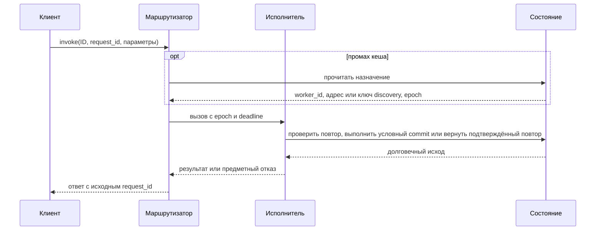
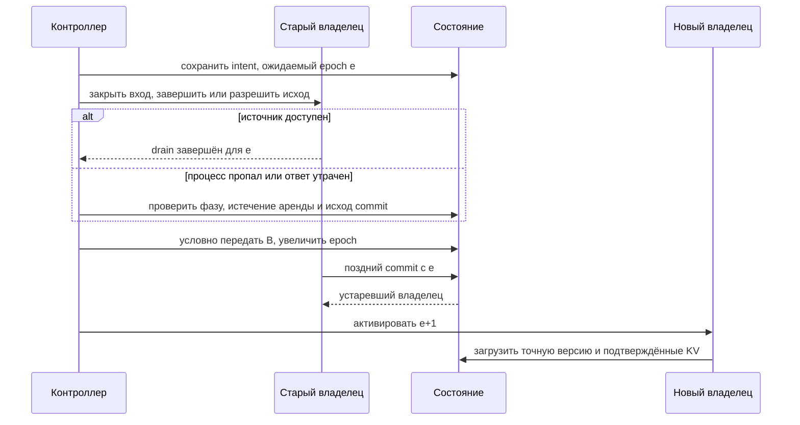

# RFC 001. Маршрутизация и размещение объектов

**Предложение для обсуждения.** Автор маршрутизации — kestfor. Эпик [#3](https://github.com/duro-d/duro/issues/3), задача [#6](https://github.com/duro-d/duro/issues/6). Основной ответственный и рецензент по всем задачам на этом этапе — kestfor. Отдельно фиксируем решение по каждой границе. Решения, перечисленные в разделе про контракты, требуют их подтверждения в [#2](https://github.com/duro-d/duro/issues/2).

Два клиента могут одновременно обратиться по одному ID через разные маршрутизаторы. Оба должны попасть к действующему владельцу либо получить ошибку, с которой можно повторить запрос. Если старый исполнитель проснётся после переноса, его запоздавший ответ не должен превратиться во вторую запись. Это основной сценарий PoC.

За основу берём закреплённое назначение в хранилище, локальный кеш на входе и один контроллер для изменения размещения. Кеш сокращает число сетевых переходов. Поколение владельца и условная фиксация в хранилище обеспечивают корректность при устаревшем кеше. Цель эксперимента — измерить цену промаха, восстановления и переноса при одинаковых гарантиях для двух политик. [Архитектура MVP](https://github.com/duro-d/duro/wiki/Architecture-MVP) · [Технические решения](https://github.com/duro-d/duro/wiki/Technical-Decisions)

## Границы и контракты

Владение относится к одному объекту. Обработчик работает с собственным KV. Объекты взаимодействуют через внешнее приложение отдельными запросами. Сохранение ID другого объекта не даёт обработчику доступа к его данным. Транзакция заканчивается на одном объекте. [Модель объекта](https://github.com/duro-d/duro/wiki/Concepts-Object)

Таблица задаёт предложения потребителя для v0. Имена сетевых методов, номера полей и типы ошибок публикуются один раз в `api/proto/duro/v1/` через #2. После принятия сюда добавляется ссылка на ревизию общего контракта.

| Взаимодействие | Что передаём и получаем | Гарантия, которую проверяют обе стороны |
| --- | --- | --- |
| Маршрутизатор вызывает исполнителя | Проверка точных байтов bundle и манифеста. Ответ связывает результат проверки с хешем. Активация принимает ID, incarnation владельца и epoch. Создание и вызов дополнительно несут неизменный request ID, операцию и параметры | Проверка пакета проходит без init. Активация существующего объекта загружает закреплённую версию. Ответ о завершении выдаётся после подтверждения состояния. Повтор активации одного поколения безопасен |
| Контроллер опрашивает исполнителя | Опрос готовности и нагрузки, глубина очереди, доля занятого времени, ограниченная выборка горячих ID. Подготовка переноса для пары (ID, epoch) закрывает вход этому поколению, завершает очередь или возвращает вызывающим техническую ошибку, разрешает исход последней операции и подтверждает drain | Ответ от другого процесса или поколения отбрасывается. Повтор подготовки возвращает текущую фазу. Признак готовности переноса относится ко всем запросам на исполнителе, включая поступившие со старым маршрутом |
| Маршрутизатор вызывает состояние | Условная регистрация проверенного пакета; метаданные, полное чтение с primary и поиск действующего назначения; проверка результата запроса вместе с исходными параметрами | Либо подтверждённые данные целой версии, либо явная ошибка. Различаются отсутствие ключа и JSON null. Состояние отвечает за доказательство долговечности при смене primary |
| Контроллер вызывает состояние | Найти/зарезервировать первое назначение, пролистать назначения по владельцу и незавершённые переходы, начать и завершить передачу условно по источнику, epoch и фазе, продлить действующее владение | Изменение назначения и проверка полномочий сериализуются с commit объекта. Нужны атомарные условия перехода, источник времени хранения и защита от команд прежнего контроллера. Идемпотентный повтор видит текущее состояние операции |
| Исполнитель вызывает состояние | Сверка объекта, параметров и результата, загрузка данных, фиксация результата с проверкой владельца и аренды | Соседи определяют этот RPC. Для маршрутизации существенны результаты «подтверждено», «точно не зафиксировано», «исход пока неизвестен». Неизвестный исход нельзя превратить в новый успех |

Предлагаем передавать JSON в Protobuf как байты UTF-8 с явным признаком присутствия там, где отсутствие допустимо. Проверять синтаксис до отправки. При сравнении параметров объект JSON сравнивается по полям без учёта порядка, массив — по позициям. Не преобразовывать все числа в Go float64 при транзите. Правила представления чисел, отклонения дублирующихся ключей, нормализации и сравнения должны иметь общие golden fixtures для всех языков. Адрес ноды отделён от `worker_id`, который создаётся заново при запуске. Предлагаем uint64 для монотонного epoch. Оставшееся время передаётся через gRPC deadline, отмена распространяется вниз.

**Что согласовать в #2.** С исполнением — семантику drain и отказа входящих вызовов старого поколения, получение нагрузки и свидетельство готовности продлевать аренду. С хранением — невидимую клиенту резервацию create, проверку повторов при отсутствии объекта, fence контроллера, перенос с восстановимой фазой, обход назначений и проверку исхода commit после смены primary. От обеих сторон нужны таблица status/details, граничные размеры сообщений и тестовые векторы. Первый совместный пример должен проходить через сгенерированные клиенты. До этого адаптеры и численные параметры ниже имеют статус предложения.

## Публичный API

Предлагаем пять операций HTTP/JSON. Для PoC единая форма пути `POST /v1/{operation}` позволяет передавать объектный ID и произвольный ключ в JSON без кодирования сегментов URL. ID объекта выбирает клиент. У каждой операции отдельная схема тела. Сервер проверяет Bearer-токен развёртывания, ограничивает число запросов в обработке, читает ограниченное тело и проверяет поля до обращения к соседям. [Правила операций и HTTP-коды](https://github.com/duro-d/duro/wiki/Functional-Requirements)

| Операция | Запрос и действия | Ответ и особые случаи |
| --- | --- | --- |
| registerType | Тип, версия, runtime, формат, методы, SHA-256 и самодостаточный ESM bundle. Клиент передаёт манифест и bundle в base64. Проверить размер, декодирование и хеш, передать исходные байты на проверку V8, после успеха условно сохранить | Тип, версия и хеш. Повтор идентичного пакета успешен. Коллизия типа и версии с другим содержимым даёт CODE_VERSION_CONFLICT. Невалидный пакет не публикуется |
| create | object_id, type, version, input и request_id. Состояние сначала разрешает повтор, затем резервирует создание, контроллер закрепляет выбранного исполнителя, тот выполняет init | Результат создания вместе с ID после атомарной записи метаданных, KV и результата. Другой create под занятым ID даёт OBJECT_ALREADY_EXISTS. Предметный отказ сохраняется без видимого объекта |
| invoke | object_id, method, argument (в том числе null), request_id. Разрешить маршрут и передать запрос с epoch | Обёртка `{"result":…}`, включая null. Метод без записей сохраняет результат. Неизвестный объект или метод даёт NOT_FOUND |
| describe | object_id. Читать подтверждённые метаданные через состояние | ID, тип, закреплённая версия и методы. Рабочая нода может быть выключена |
| read | object_id. Прочитать через состояние одну подтверждённую версию на primary | Полный KV, включая сохранённый null. Неизвестный объект даёт NOT_FOUND, недоступное хранилище — UNAVAILABLE |

Область дедупликации create и invoke общая — (object_id, request_id). Хранение сверяет вид операции и все параметры до выдачи сохранённого ответа. Для конкурирующих create резервирует один intent с выбранными входными данными. Пока исход первой операции неизвестен, несовместимому конкуренту возвращается временная недоступность. После разрешения проверяются занятый ID и конфликт параметров. Резервация не видна в read/describe. Техническая ошибка init позволяет продолжить или освободить резервацию условно по поколению; при отказе процесса контроллер подбирает оставшуюся запись. У каждой резервации уникальный токен. Выдача, освобождение и commit init условны по токену, request_id и epoch. Хранилище сохраняет монотонность поколений и после освобождения невидимой резервации. Это защищает новое создание на той же ноде от позднего init старого запроса. Успешный init никогда не выполняется повторно для восстановления объекта. Отказ по init доступен по ключу запроса даже при последующем создании объекта другим запросом.

SDK генерирует и отдаёт приложению request_id **до первой отправки**. Повтор сохраняет тело и ID. Стартовый общий deadline 5 с, максимум три отправки, полный jitter между попытками в диапазоне от 0 до min(500 мс, 50 мс × 2ᵏ) после k-й неудачи, k начинается с нуля. При каждой отправке SDK выставляет таймаут HTTP-клиента по оставшемуся времени и передаёт тот же остаток в миллисекундах в предложенном заголовке Duro-Timeout-Ms. На входе сервер ограничивает значение своим максимумом, создаёт контекст от момента приёма заголовков и наследует его при lookup и вызове. Отключение клиента отменяет ожидание. Если времени нет, SDK возвращает последнюю ошибку с ID и признаком неизвестного исхода. Приложение может продолжить с тем же ID в новом окне. Завершённый DOMAIN_REJECTED возвращается один раз как результат запроса с HTTP 422.

| Событие или Duro code | HTTP | Действие клиента |
| --- | --- | --- |
| INVALID_ARGUMENT / UNAUTHORIZED / NOT_FOUND | 400 / 401 / 404 | Исправить запрос, токен или ID |
| CODE_VERSION_CONFLICT / OBJECT_ALREADY_EXISTS / REQUEST_ID_CONFLICT | 409 | Вернуть точный code вызывающему |
| LIMIT_EXCEEDED / DOMAIN_REJECTED | 413 / 422 | Вернуть отказ |
| OVERLOADED / UNAVAILABLE / обрыв соединения | 503 либо отсутствующий ответ | Повтор с задержкой в бюджете. Перегрузка сама по себе не инициирует перенос |
| EXECUTION_TIMEOUT / INTERNAL_ERROR | 504 / 500 | Передать ошибку; повтор по решению приложения с прежним ID. INTERNAL_ERROR скрывает внутренние данные |

Предложение для gRPC — INVALID_ARGUMENT, UNAUTHENTICATED, NOT_FOUND, ALREADY_EXISTS/FAILED_PRECONDITION, RESOURCE_EXHAUSTED, UNAVAILABLE, DEADLINE_EXCEEDED и INTERNAL несут структурированный Duro code. RESOURCE_EXHAUSTED для размера и для перегрузки различается по details. Истечение сетевого deadline во время commit возвращает временную недоступность с неопределённым исходом; EXECUTION_TIMEOUT относится к подтверждённому таймауту обработчика. Устаревший epoch — внутренняя причина обновить маршрут. Одна пересылка после явного отклонения старого поколения допустима в том же бюджете. При потере ответа перенаправлять запрос параллельно на несколько исполнителей запрещено. Автоматические транспортные повторы изменяющих RPC выключены.

## Маршрут вызова

Предлагаемый отдельный Go-модуль `routing/` собирает один бинарник. Входной HTTP-обработчик, gRPC-клиенты соседей, резолвер с ограниченным LRU и контроллер с наблюдением etcd работают в одном процессе. Все экземпляры принимают обычные запросы. Только избранный контроллер назначает владельца. При необходимости назначения follower обращается к лидеру по внутреннему интерфейсу маршрутизации. Балансировка входа и список доступных адресов SDK обеспечивают обход отказавшего маршрутизатора.

При попадании в кеш нет обращения к etcd на каждый запрос. Одновременные промахи по ID объединяются в один запрос назначения с отдельным ограниченным контекстом. Отмена одного клиента не отменяет запрос для остальных. Устаревшую запись удаляем условно по паре (worker_id, epoch), чтобы поздняя ошибка не стёрла свежий маршрут. Более старый поздний ответ на lookup не заменяет запись нового поколения. Подозрение на отказ переводит вызов к проверке назначения. Успех из кеша маршрутов или локального кеша результатов никогда не выдаётся.

Если invoke не находит объекта, состояние различает завершённый повтор, конфликт request_id и неизвестный ID. Затем возвращается соответствующий код. Переход из холодного состояния загружает закреплённые код и данные; повторная активация на текущей ноде может переиспользовать подтверждённое состояние. Объект создаётся только через create.

## Контроллер и владение

etcd содержит регистрации процессов под lease и выборы лидера. После snapshot списка контроллер продолжает watch с revision + 1. После compaction заново читает snapshot; при потере сессии прекращает новые решения и отменяет текущие RPC. Между потерей лидерства и отменой уже отправленной команды возможна гонка. Предлагаем передавать в состояние монотонный term выборов и регистрировать его при вступлении в лидерство. Состояние отвергает команды из меньшего term после регистрации нового; смена term и проверка в транзакциях должны сериализоваться. Источники term предполагают непрерывную историю кластера etcd; переинициализация после утраты кворума требует отдельной процедуры вывода старых контроллеров. [Гарантии etcd](https://etcd.io/docs/v3.6/learning/api_guarantees/)

Запись назначения включает ID объекта, worker_id, epoch, lease_until. Для операции переноса хранилище сохраняет источник, цель, ожидаемый epoch, фазу и ID перехода, чтобы другой лидер мог его продолжить. Смена владельца и commit используют один порядок сериализации у состояния. Право записи требует действительных worker_id и epoch и действующей аренды по времени хранения. Предлагаемые значения для стенда — владение 9 с, продление раз в 3 с, etcd TTL процесса 6 с. Это параметры эксперимента. Контроллер продлевает только подтверждённые активным процессом назначения пакетами с ограниченным размером; при потере его подтверждения аренда истекает. Для проверки массового продления измеряем число строк и нагрузку primary. Состояние разрешает продление только до lease_until, при совпадении worker_id, epoch, term и допустимой фазы. Истёкшее владение требует нового поколения даже при повторном выборе того же процесса. Для нового epoch исполнитель сбрасывает рабочую копию и загружает подтверждённое состояние. Само присутствие записи в etcd не подтверждает право владельца.

| Состояние | Допустимое действие и защита от гонки |
| --- | --- |
| Назначение отсутствует | Для нового create атомарно создать резервацию, для восстановления существующего объекта проверить его метаданные. Условное назначение выдаёт epoch. При проигранной гонке читаем фактически выбранное назначение |
| Активен W, поколение e | Вызовы идут W. Перенос начинается с условной записи intent на e. Два лидера или повтор одной команды не создают двух действующих назначений |
| Подготовка W → V | Контроллер просит W закрыть приём для объекта и выдать подтверждение drain. Закрепление intent запрещает обычное бесконечное продление. Контроллер допускает старый незавершённый commit в пределах его полномочий, разрешает исход, затем делает условную передачу. Для запоздавших маршрутизаторов вход у W остаётся закрыт до смены поколения |
| Источник пропал | Дождаться допустимого перехода по времени хранения. Состояние сериализует переход с последним commit; при неопределённом исходе проверяет долговечность. Контроллер получает подтверждение безопасного перехода или оставляет объект временно недоступным. Обрыв TCP или удаление из etcd сами по себе этой проверки не заменяют |
| Назначен V, поколение e+1 | Активировать V с закреплённой версией и подтверждёнными данными. Завершить intent, разрешить вызовы. При сбое V повторить активацию либо после безопасного отзыва передать другому процессу с новым epoch. Старое поколение восстановлению не подлежит |

Если источник пропал, контроллер может не знать request_id последнего вызова. Поэтому ответ о безопасной передаче должен удостоверять состояние целого объекта: после сериализации со всеми commit старого поколения хранение предоставляет новому поколению долговечную версию KV и таблицы результатов на той же границе. Зафиксированное до этой границы входит в восстановление, более поздняя попытка с e отклоняется. При неизвестной долговечности на текущем primary хранение оставляет переход незавершённым. Детальный механизм подтверждения — часть контракта состояния в #2.

После выборов лидер в первую очередь восстанавливает незавершённые переходы постранично, затем ищет назначения исчезнувших процессов по индексу владельца. Отдельный периодический проход выбирает просроченные назначения по времени хранения, включая зарегистрированные живые процессы. Стабильный курсор и повторный проход покрывают записи, добавленные во время сканирования. Использует ограниченный пул задач, повтор с задержкой и сверку текущей фазы на каждом шаге. Смена маршрута проявляется по следующему lookup либо инвалидации при явном stale-ответе. Падение лидера после записи нового epoch, но до ответа новому владельцу, приводит к идемпотентной активации того же поколения. Восстановление запускается и без первого клиентского обращения.

При потере etcd маршрутизатор может использовать известный адрес для существующего назначения, пока состояние принимает commit с действующей арендой. Изменения размещения приостанавливаются до восстановления лидерства и актуального состава. При потере хранения операции с обязательной фиксацией, read и describe возвращают UNAVAILABLE. После восстановления хранилище подтверждает исход предыдущего вызова до продолжения работы объекта. Остаток времени на часах маршрутизатора влияет на таймаут ожидания; проверку права записи выполняет хранение.

## Политики размещения

Оператор выбирает политику до прогона. Обе используют один набор готовых процессов в режиме «активна» с доступной ёмкостью. Входящий вызов существующего объекта сохраняет действующего владельца независимо от выбранной политики. Если набор пуст, контроллер возвращает UNAVAILABLE.

* **Rendezvous hashing.** Для каждой пары из object_id и worker_id вычисляем SHA-256 от двух полей UTF-8 с явными четырёхбайтовыми длинами big-endian. Выигрывает максимальный беззнаковый результат в лексикографическом порядке байтов. При равенстве берём меньший worker_id. Выбор воспроизводим при перестановке списка нод.
* **По нагрузке.** Раз в секунду опрашиваем готовность, ожидающие вызовы и долю занятого времени рабочих слотов за интервал. При равных ресурсах PoC берём минимум `0.5 × min(queue / queue_limit, 1) + 0.5 × busy_fraction`, при равенстве — лучший rendezvous score. Обе дроби в диапазоне [0,1]. Выборки старше 3 с исключаем из нагрузочного сравнения. Если нет свежих метрик ни от одной готовой ноды с подтверждённой доступностью, для нового размещения используем HRW среди таких нод и считаем fallback. Ребалансировку по устаревшим данным приостанавливаем.

Стартовая настройка ребалансировки — разница score более 0,25 в течение трёх последовательных замеров. Для нагрузки выбираем объект из top-16 по частоте вызовов источника за последнее окно, чей перенос уменьшает оценочный разрыв. Считаем долю объекта в работе источника по времени исполнения, вычитаем её из загрузки источника и прибавляем к загрузке цели при сравнении кандидатов. Если оценка не улучшилась, перемещение пропускаем. Для HRW при добавлении ноды рассматриваем ограниченную страницу назначений и переносим кандидатов, которым новый состав назначил бы другую ноду. Ручной перенос использует тот же протокол и те же ограничения. Старты переносов ограничены одним в секунду на кластер и одним незавершённым плановым переносом; cooldown одного объекта 60 с. Параметры фиксируем до сравнительного прогона. Потеря ноды имеет приоритет над плановой ребалансировкой и отдельный ограниченный пул восстановления.

Пересчитывать хеш для каждого invoke было бы проще, но после добавления ноды кеши разных маршрутизаторов могли бы выбрать разные цели. Хранить назначения объектов в etcd означало бы согласовывать этот реестр с проверкой commit в PostgreSQL. Выбранный вариант использует уже необходимую транзакционную границу состояния. Цена — lookup при промахе и расход primary на назначения, продления и смену поколения. Они измеряются отдельно.

**Опциональное расширение FR-11.** Режим участия процесса (резерв, активен, выводится) отделён от доступности. Для отдельного опыта предлагаем min=2, max=4, включать готовый резерв после 30 с средней занятости выше 80%, начинать вывод после 120 с ниже 30%, cooldown 120 с. Минимум в конфигурации хотя бы один. Устаревшие метрики или нехватка ёмкости запрещают вывод. Выводящаяся нода сохраняет вызовы текущих владельцев, новые назначения исключаются. После drain всех объектов контроллер сверяет отсутствие владений и незавершённых операций и лишь затем переводит процесс в резерв. Отказ в процессе вывода проходит обычное восстановление. Автоматическое изменение пула выключено для обязательных прогонов. Создание VM и изменение состава БД не входят в этот опыт. [FR-11 и условия расширения](https://github.com/duro-d/duro/issues/6)

## Эксплуатация

Начальные лимиты маршрутизатора на процесс — 64 МиБ и 100 000 записей LRU (первый достигнутый предел), TTL 30 с, максимум 256 обрабатываемых HTTP-запросов и 64 параллельных промаха к состоянию. Контроллер читает назначения страницами по 128, обрабатывает до 8 восстановлений параллельно. Ограничиваем длину ID в согласованной схеме v0, учитываем байты ключей в бюджете. При исчерпании бюджета немедленно возвращаем OVERLOADED. Конфигурация и эффективные лимиты выводятся при старте. Измеряем RSS и стоимость промаха при холодном старте.

Пакет с манифестом до 1 МиБ проверяется после декодирования, отдельно ставим верхний предел 2 МиБ на транспортную обёртку регистрации. Внешние create/invoke — полное тело до 64 КиБ UTF-8. Результат метода до 64 КиБ, весь KV и буфер изменений по 1 МиБ, ключ 256 байт, обработчик 1 с, ожидающие вызовы на объект/ноду 100/1000. Последние пределы применяют исполнение и состояние. Контролируемый размер внутренних ответов должен вмещать 1 МиБ KV с обёрткой. Общий deadline охватывает очередь, активацию, выполнение и commit. [NFR-04](https://github.com/duro-d/duro/wiki/NFR-04)

HTTP health проверяет живой процесс, readiness — загруженную конфигурацию, доступность пути к состоянию и возможность обслуживать публичный API. Потеря лидерства сама по себе не снимает работающие маршрутизаторы со входа. Внутренние RPC доступны только участникам стенда. Prometheus получает задержки HTTP, lookup, вызова, drain и активации, причины ошибок, hit/miss, размер кеша, число переносов, восстановлений и отклонений старых поколений. Отдельные счётчики для попыток и завершённых клиентских операций. Метки ограничены именем операции, кодом, политикой и фазой. JSON-журнал содержит object_id, request_id, worker_id, epoch, длительность и исход; для переноса также цель и причину. Аргументы, токены и KV в журнал не входят.

## Проверка маршрутизации

### Изолированный стенд

Go-тест проверяет вычисления политики, правила кеша и бюджет попыток с управляемыми часами. Следующий уровень запускает настоящий бинарник маршрутизатора, etcd и отдельные gRPC-серверы исполнения и состояния, собранные из принятых общих Protobuf-определений. Один и тот же HTTP-клиент работает с этим стендом и с полноценным Duro. Python-сценарий поднимает процессы с временными каталогами, ждёт готовности, вызывает публичный API и сохраняет журнал событий при падении. Отдельный профиль запускает два маршрутизатора для смены лидера. Результат прогона содержит команду, версии, seed и включённые точки отказа.

Заглушка состояния хранит назначения, поколения, аренды, подтверждённые данные и результаты отдельно от живых процессов исполнителей. Меняет владельца условно, при фиксации за один шаг проверяет полномочия и повтор. У неё раздельные события «попытка видна» и «результат подтверждён». Заглушка исполнителя умеет удержать вызов перед фиксацией, потерять ответ после неё, сообщить заполненную очередь, перестать отвечать и вернуться со старым поколением. Сценарий ставит барьер на конкретный объект, запрос и фазу, дожидается события и только затем вносит отказ. Управление заглушками доступно лишь тестовому процессу. Оно не добавляет диагностические RPC в общий контракт. Стенд проверяет решения маршрутизатора и переданные поля. Гарантии V8, PostgreSQL и Patroni проверяются отдельным прогоном с реальными модулями.

### Откуда брать ожидаемый результат

Клиент записывает начало и конец операции, ID, параметры и ответ каждой попытки. Стенд отдельно пишет события назначения, передачи, попытки фиксации и её подтверждения. Повтор с тем же ID разрешает неизвестный исход. После остановки потока тест сопоставляет уникальные завершённые операции со снимком объекта через публичный `read`. Счётчик отправленных RPC сам по себе ничего не говорит о числе применённых команд. Для квоты остаток должен равняться исходному ресурсу за вычетом сумм успешных уникальных списаний и оставаться неотрицательным. Для аукциона подтверждённые ставки растут в порядке применения, итоговые цена и участник соответствуют выигравшей ставке, а закрытие исключает последующие успешные ставки. При конкурентных вызовах допустим любой порядок, совместимый с уже завершившимися ответами. Предметные отказы учитываются отдельно. Неразрешённый исход помечается в отчёте и препятствует выводу о корректности прогона.

### Гонки, которые стенд должен воспроизвести детерминированно

| Последовательность событий | Наблюдаемый результат |
| --- | --- |
| Оба маршрутизатора запомнили A/e. Лидер недоступен дольше срока аренды; A продолжает регистрироваться в etcd. После выборов A опять выбран для того же объекта | Продление e отклонено. Обход просроченных назначений выдаёт e+1 без клиентского запроса. A загружает подтверждённые данные. Удержанный commit с e отклоняется |
| Источник начал commit, связь оборвалась, контроллер знает только ID объекта. Следом приходит другой метод с другим request_id | Цель допускает следующий метод лишь после подтверждённой границы предыдущего поколения. Учитывается ровно один из исходов предыдущей операции. При неопределённости клиент получает UNAVAILABLE |
| Технический отказ init, освобождение резервации, новый create на той же ноде, затем поздний ответ и попытка commit старого init | Условные освобождение и commit старого токена не меняют новую резервацию. Сохраняются только данные нового успешного создания |
| У первого HTTP-вызова осталось 100 мс, lookup занял 80 мс; следующий RPC задержан | Дедлайн дочернего RPC не позже дедлайна HTTP-обработчика. SDK прекращает новые попытки после общего срока, отдаёт исходный request_id |

### Требования и критерии

| Основание | Раздел RFC | Проверка и ожидаемый результат |
| --- | --- | --- |
| [FR-01](https://github.com/duro-d/duro/wiki/FR-01) | [Публичный API](#публичный-api) | Повтор идентичного пакета успешен, другой манифест или код под той же версией даёт `CODE_VERSION_CONFLICT`. Исполнитель отклоняет повреждённый пакет, состояние не получает регистрацию, `init` не запускается. |
| [FR-02](https://github.com/duro-d/duro/wiki/FR-02) | [Маршрут вызова](#маршрут-вызова) | Одновременные создания через два маршрутизатора оставляют один объект. Одинаковые ID и параметры дают один результат, другой ID создания занятого объекта даёт `OBJECT_ALREADY_EXISTS`. После отказа `init` повтор возвращает тот же предметный отказ, `describe` возвращает `NOT_FOUND`. |
| [FR-03](https://github.com/duro-d/duro/wiki/FR-03), [FR-05](https://github.com/duro-d/duro/wiki/FR-05) | [Публичный API](#публичный-api) | `describe/read` работают при остановленных исполнителях и доступном primary. Методы и тип совпадают до и после переноса. Один ответ чтения содержит целую версию, после завершённой записи он видит её или более позднюю. Для неизвестного ID нет назначения. При недоступном состоянии — ошибка доступности. |
| [FR-04](https://github.com/duro-d/duro/wiki/FR-04), [NFR-01](https://github.com/duro-d/duro/wiki/NFR-01) | [Маршрут вызова](#маршрут-вызова) | Два клиента повторяют команду одновременно, включая попытку с устаревшим маршрутом. Совпадают ID, параметры, итог и эффект. Другие параметры дают `REQUEST_ID_CONFLICT`. Повтор метода без записей и предметного отказа возвращает исходный результат. После исключения, ошибки сериализации или таймаута в данных нет частичных записей. Отдельный объект продолжает работу во время удержания первого. Порядок исполнения и изоляцию буфера подтверждает интеграционный прогон. |
| [FR-06](https://github.com/duro-d/duro/wiki/FR-06) | [Политики размещения](#политики-размещения) | Для известного набора ID, состава и метрик ожидаемые назначения вычисляются по формуле RFC. Перестановка входного списка не меняет выбор при равенстве. При недоступности кандидата и обновлении нагрузки новые назначения используют допустимые ноды, прежний владелец остаётся до условной смены. |
| [FR-07](https://github.com/duro-d/duro/wiki/FR-07), [FR-09](https://github.com/duro-d/duro/wiki/FR-09) | [Контроллер и владение](#контроллер-и-владение) | Инициировать перенос при активной операции, остановить источник до фиксации и после фиксации до ответа, затем вернуть его с задержанным запросом. Ответ с новым поколением приходит от цели, запись старого владельца отклонена, повтор даёт один эффект. Отдельно остановить лидера на каждой стороне условной смены и проверить завершение новым лидером. Измерить паузу и объём загруженных данных. |
| [FR-08](https://github.com/duro-d/duro/wiki/FR-08), [NFR-04](https://github.com/duro-d/duro/wiki/NFR-04) | [Публичный API](#публичный-api), [Эксплуатация](#эксплуатация) | Проверить значения на пределе и на байт больше. Пакет с манифестом — 1 МиБ, тело create/invoke и результат — по 64 КиБ UTF-8. Допустимое состояние объёмом 1 МиБ проходит через внутренний RPC и read с обёрткой. На полном стенде проверяются ключ 256 байт, состояние и буфер по 1 МиБ, обработчик 1 с, очереди объекта и ноды 100/1000. При заполнении очереди клиент получает `OVERLOADED`, общий deadline и предел попыток сохраняются. Под длительной нагрузкой очереди и память ограничены, после снижения потока обслуживание возобновляется. |
| [FR-10](https://github.com/duro-d/duro/wiki/FR-10), [NFR-08](https://github.com/duro-d/duro/wiki/NFR-08) | [Эксплуатация](#эксплуатация) | Найти потерянный ответ, повтор, перенос и смену поколения по журналу. В Grafana видны задержка, успешные операции, отказы, загрузка, очереди и переносы на одной временной шкале. Появление новых object_id и request_id не создаёт новых рядов в Prometheus. |
| [NFR-02](https://github.com/duro-d/duro/wiki/NFR-02), [NFR-03](https://github.com/duro-d/duro/wiki/NFR-03) | [Контроллер и владение](#контроллер-и-владение), [Границы и контракты](#границы-и-контракты) | По 10 остановок исполнителя в каждой точке, до фиксации и после неё до ответа. Измерять от отказа до успешного долговечно подтверждённого изменяющего RPC, ориентир 30 с. При смене primary во время commit и потере одной VM на полном стенде ориентир 60 с. Повтор возвращает исходный результат после подтверждения долговечности. Без кворума или подходящей реплики успех недопустим. После полного перезапуска и очистки кешей проверить исходные версию и хеш пакета, результат повтора, данные и отсутствие повторного init. |
| [NFR-05](https://github.com/duro-d/duro/wiki/NFR-05) | [Политики размещения](#политики-размещения), [Нагрузочный эксперимент](#нагрузочный-эксперимент) | Для двух политик выполнить все профили, сравнить устойчивые успешные операции/с в пределах согласованных p99 и доли ошибок. Инварианты данных обязательны при каждой нагрузке. |
| [NFR-06](https://github.com/duro-d/duro/wiki/NFR-06) | [Публичный API](#публичный-api) | Без токена и с неверным токеном все публичные операции получают 401 до обращения к соседям. В логах отсутствуют контрольный токен, входной JSON и состояние. Интеграция проверяет отсутствие доступа приложения к сети и чужому объекту из метода и init. |
| [NFR-07](https://github.com/duro-d/duro/wiki/NFR-07), [NFR-09](https://github.com/duro-d/duro/wiki/NFR-09) | [Изолированный стенд](#изолированный-стенд), [Эксплуатация](#эксплуатация) | Отдельная сборка Go и запуск сценариев одной командой. Тот же набор публичных запросов выполнить через реальные модули. Проверку потери VM проводить минимум на трёх VM с разнесёнными репликами, несколькими маршрутизаторами и сервисами состояния, минимум тремя исполнителями, тремя PostgreSQL и тремя участниками etcd. Проверить фактическую строгую синхронную репликацию и доступный клиентский вход. |
| [NFR-10](https://github.com/duro-d/duro/wiki/NFR-10) | [Границы и контракты](#границы-и-контракты), [Порядок реализации](#порядок-реализации) | Цель первых двух недель разработки — сквозной вызов через три реальные службы. На чистом стенде участник по инструкции регистрирует аукцион и квоту, выполняет примеры и воспроизводит отказ. При изменении общего API в том же цикле обновляются заглушки и примеры. |
| [FR-11](https://github.com/duro-d/duro/wiki/FR-11), отдельно | [Политики размещения](#политики-размещения) | При реализации расширения воспроизвести рост и снижение нагрузки, потерю ноды во время вывода и отсутствие свободной цели. Проверить границы min/max, окна и cooldown, сохранение маршрута до передачи и запрет уменьшения по устаревшим данным. В сравнении основных политик размер пула фиксирован. |

### Нагрузочный эксперимент

1. После первого сквозного запуска зафиксировать в репозитории оборудование и размещение процессов, версии, лимиты, параметры каждой политики, набор данных и хеши двух обработчиков. По первому измерению согласовать целевые успешные операции/с, максимальный p99 и долю технических ошибок до сравнения. Цели, полученные только на заглушках, недостаточны для приёмки MVP.
2. До начала замера загрузить 100 000 объектов, около 1 КиБ на объект, и выбрать 10 000 активных. Отдельный генератор k6 подаёт заданный поток с фиксированным seed, 80% изменяющих вызовов и 20% текущих чтений. У каждой новой операции свой ID, повторы того же действия учитываются отдельно. Сверять заданный и фактический поток, включая пропущенные старты генератора.
3. На одинаковой конфигурации маршрутизации и хранения, с одинаковым ресурсом на исполнителя, сравнить фиксированные пулы 1/2/4. Профили — короткая операция с состоянием и операция с фиксированной вычислительной работой. Для каждой точки прогрев 60 с, замер от 5 мин, не менее трёх повторов. Менять порядок политик между повторами. Запустить равномерный поток, 80% обращений к 20% активных объектов, смену популярной группы, добавление исполнителя с переносом, перегрузку со снижением потока и отказ под нагрузкой. Сценарий добавления ноды выполняется отдельно от сравнений фиксированного пула.
4. Сохранить исходные измерения, входную и успешную скорость, p50/p95/p99, технические ошибки, предметные отказы, таймауты, повторы, CPU/RAM, очереди, задержку commit, расход диска, паузы и байты переносов. Для вычислительного профиля рост устойчивой скорости с одного до четырёх исполнителей должен превосходить разброс повторов при согласованных p99 и доле ошибок. Для короткого профиля указывается ограничивающий компонент всего пути. Для обеих политик отдельно объясняется влияние перекоса и цена переноса. Непройденная цель или незавершённая проверка инварианта остаётся открытой в отчёте.

## Порядок реализации

После принятия общего [контракта v0](https://github.com/duro-d/duro/issues/2) и [RFC](https://github.com/duro-d/duro/issues/6) работы ниже становятся дочерними issues [эпика маршрутизации](https://github.com/duro-d/duro/issues/3). Номер в таблице задаёт зависимость внутри плана. Независимую работу над примерами, стендом и политиками можно вести параллельно. Для каждой карточки результатом ревью служат указанные артефакт и проверка.

| № | Задача и результат | Зависит от | Критерий завершения |
| --- | --- | --- | --- |
| 1 | Собрать отдельный Go-модуль и контрактный стенд. Бинарник маршрутизатора, конфигурация, сгенерированные клиенты v0, заглушки двух сервисов и etcd | v0 | В чистом окружении команда запуска поднимает профиль, ждёт готовности и завершает его. Несовместимая схема обнаруживается сборкой. |
| 2 | Реализовать HTTP/JSON и клиентский SDK для пяти операций. Включить токен, пределы тел, дедлайны, коды ошибок и идентификаторы | 1 | Табличные тесты проверяют вход и каждый публичный код. Через сеть проходят регистрация, создание, вызов и чтения. `read/describe` не вызывают исполнителя. |
| 3 | Реализовать обнаружение, выбор лидера и условное первое назначение с rendezvous hashing | 1 | Два экземпляра одновременно обрабатывают создание, получается одно действующее назначение. Истечение сессии и перезапуск лидера воспроизводятся на etcd. |
| 4 | Провести вызов через кешированное назначение и безопасный повтор. Проверить конфликт параметров и неопределённый исход | 2, 3 | Две реплики маршрутизатора, устаревший кеш и потеря ответа дают один подтверждённый эффект. Нет успеха по неподтверждённому результату. Как только доступны соседи, эта цепочка запускается через три реальные службы для первого сквозного вызова. |
| 5 | Реализовать ручной перенос, автоматическое восстановление и повторное согласование после смены лидера | 4 | На фазовых барьерах текущая операция разрешается, старое поколение отклоняется, новый владелец принимает вызовы, клиентский ID сохраняется. |
| 6 | Добавить нагрузочную политику и ограниченное переразмещение | 3, 5 | Воспроизводимый ряд метрик проверяет выбор и стабильность, пропадание метрик и отказ кандидата. Для двух политик применён один набор тестов корректности. |
| 7 | Добавить диагностику маршрута, контроллера и переноса | 3, 4; события переноса из 5 | По одному ID восстанавливается последовательность попыток и смена владельца. Дашборд показывает метрики при перекосе и отказе. Есть тест на отсутствие секретов и ID в метках. |
| 8 | Закрепить независимые E2E и контроль регрессий в GitHub Actions | 4, 5, 6, 7 | Одна команда на отдельной сборке воспроизводит таймаут, потерю ответа, перегрузку, смену лидера и возврат старого владельца, сверяет инварианты. CI сохраняет диагностический журнал сбоя. |
| 9 | Проверить полный стенд и восстановление под нагрузкой | 4, 5, 7 и реальные модули исполнения и состояния | Опубликованы воспроизводимые результаты с двух типов объектов, замерами NFR-02 на трёх VM и сверкой подтверждённых ответов после восстановления. |
| 10 | Согласовать цели после первого сквозного измерения и выполнить NFR-05 | План — после 4 и первого сквозного вызова; сравнение — после 6–9 | План с численными целями имеет ревизию до сравнений. Приложены конфигурации, seed, исходные результаты, сравнение двух политик и разбор узкого места. |
| 11 | Подготовить инструкцию и воспроизводимое демо | 8–10 | Независимый участник повторяет запуск аукциона и квоты, перенос и отказ, находит соответствующие метрики и ограничения. Принятый RFC доступен из Wiki и эпика. |

Опциональную реализацию FR-11 можно вынести в отдельную карточку после задач 5–7, когда есть проверенные перенос, измерения нагрузки и безопасный вывод ноды.
