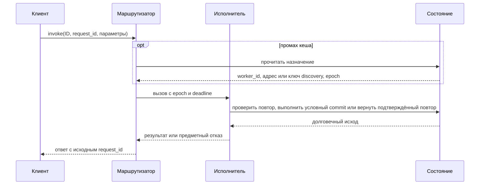
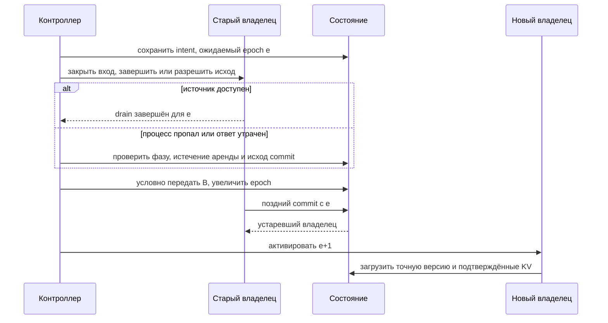

# RFC 001. Маршрутизация и размещение объектов

RFC открыт для обсуждения в рамках [эпика #3](https://github.com/duro-d/duro/issues/3) и [задачи #6](https://github.com/duro-d/duro/issues/6). Автор маршрутизации kestfor отвечает за все задачи этого этапа и выступает их основным рецензентом. Владельцы смежных модулей подтверждают каждую границу отдельно в [#2](https://github.com/duro-d/duro/issues/2).

В основном сценарии PoC два клиента одновременно обращаются к одному объекту через разные маршрутизаторы. Каждый запрос должен попасть к действующему владельцу или завершиться ошибкой, при которой клиент может его повторить. Если прежний исполнитель вернётся после переноса, его запоздавший ответ не должен привести к повторной записи.

Хранилище закрепляет объект за исполнителем. Маршрутизатор кеширует назначение, чтобы сократить число сетевых переходов. Менять размещение может один контроллер. Хранилище принимает запись только после проверки поколения владельца, даже если маршрут в кеше устарел. В эксперименте сравним две политики с одинаковыми гарантиями и измерим стоимость промаха кеша, восстановления и переноса. [Архитектура MVP](https://github.com/duro-d/duro/wiki/Architecture-MVP) · [Технические решения](https://github.com/duro-d/duro/wiki/Technical-Decisions)

## Границы и контракты

Владельца назначают каждому объекту отдельно. Транзакция охватывает один объект, а обработчик работает только с его KV. Обработчик может сохранить ID другого объекта. Чтобы обратиться к данным того объекта, внешнее приложение должно отправить отдельный запрос. [Модель объекта](https://github.com/duro-d/duro/wiki/Concepts-Object)

Маршрутизацию разрабатываем первой. Для её PoC фиксируем, какие данные и гарантии нужны от исполнения и хранения. Эти условия действуют и для заглушек. Имена RPC, номера полей и коды ошибок для двух границ маршрутизатора храним в `api/proto/duro/v1/`. Владельцы соседних модулей смогут проверить свои реализации на тех же примерах. Контракт исполнения с хранением они разрабатывают самостоятельно. [Рабочие схемы и проверка gRPC для PoC](https://github.com/duro-d/duro/pull/21)

| Взаимодействие | Что передаём и получаем | Гарантия, которую проверяют обе стороны |
| --- | --- | --- |
| Маршрутизатор вызывает исполнителя | Маршрутизатор отправляет точные байты bundle и манифеста. Исполнитель возвращает хеш вместе с результатом проверки. Для активации нужны ID, идентификатор экземпляра владельца (incarnation) и epoch. Для создания и вызова нужны также неизменный request ID, операция и параметры | Исполнитель проверяет пакет без запуска init. При активации существующего объекта он загружает закреплённую версию, а о завершении операции сообщает после подтверждения состояния. Активацию одного поколения можно повторить |
| Контроллер опрашивает исполнителя | Исполнитель сообщает готовность, глубину очереди, долю занятого времени и ограниченную выборку горячих ID. При подготовке переноса пары (ID, epoch) он закрывает вход для этого поколения, обрабатывает очередь или возвращает вызывающим техническую ошибку. Выяснив исход последней операции, подтверждает drain | Контроллер отбрасывает ответ от другого процесса или поколения. При повторе подготовки исполнитель возвращает текущую фазу. Подтверждение готовности к переносу охватывает все запросы на исполнителе, в том числе пришедшие по старому маршруту |
| Маршрутизатор вызывает сервис состояния | Маршрутизатор условно регистрирует проверенный пакет, запрашивает метаданные, полный KV с primary и действующее назначение. При повторе проверяет результат запроса вместе с исходными параметрами | Сервис возвращает целую подтверждённую версию или явную ошибку. По ответу можно отличить отсутствующий ключ от JSON null. При смене primary сервис состояния подтверждает долговечность данных |
| Контроллер вызывает сервис состояния | Контроллер находит или резервирует первое назначение, постранично читает назначения по владельцу и незавершённые переходы. Он начинает и завершает передачу при совпадении источника, epoch и фазы, а также продлевает действующее владение | Хранилище сериализует смену назначения и проверку полномочий с commit объекта. Оно атомарно проверяет условия перехода, отсчитывает время по своим часам и отклоняет команды прежнего контроллера. Повтор команды возвращает текущее состояние операции |
| Исполнитель вызывает сервис состояния | Исполнитель сверяет объект, параметры и результат, загружает данные и фиксирует результат с проверкой владельца и аренды | Контракт этого RPC определяют команды исполнения и хранения. Маршрутизатор различает ответы «подтверждено», «точно не зафиксировано» и «исход пока неизвестен». Для ответа об успехе нужно подтверждение |

Для JSON в Protobuf предлагаем байты UTF-8. Если поле можно пропустить, нужен явный признак его присутствия. Отправитель проверяет синтаксис до отправки. При сверке параметров сравниваем поля объектов без учёта порядка и элементы массивов по позициям. При передаче через Go нельзя преобразовывать все числа в float64. Для всех языков нужны общие эталонные примеры на представление чисел, отклонение дублирующихся ключей, нормализацию и сравнение.

Каждый запуск процесса создаёт новый `worker_id`, независимый от адреса ноды. Для монотонного epoch предлагаем uint64. Вложенные вызовы получают оставшееся время через gRPC deadline и наследуют отмену.

В #2 команде исполнения предстоит согласовать, как работает drain, как исполнитель отклоняет входящие вызовы старого поколения, сообщает о нагрузке и подтверждает готовность продлить аренду. С командой хранения нужно согласовать скрытую от клиента резервацию create, проверку повторов при отсутствии объекта, защиту от команд прежнего контроллера (fence), возобновление переноса с сохранённой фазы, обход назначений и проверку исхода commit после смены primary.

Для двух границ маршрутизации задаём соответствие status/details, предельные размеры сообщений и контрольные примеры. Первый стенд использует сгенерированные клиенты и заглушки. Когда появятся соседние модули, повторим на них те же проверки и зафиксируем согласованную ревизию в #2.

## Публичный API

Для пяти операций HTTP/JSON предлагаем путь `POST /v1/{operation}`. Клиент сам выбирает ID объекта и передаёт его и произвольный ключ в JSON. Кодировать сегменты URL не требуется. У каждой операции своя схема тела. До обращения к другим сервисам сервер проверяет Bearer-токен развёртывания, ограничивает число одновременных запросов и размер читаемого тела, затем проверяет поля. [Правила операций и HTTP-коды](https://github.com/duro-d/duro/wiki/Functional-Requirements)

| Операция | Запрос и действия | Ответ и особые случаи |
| --- | --- | --- |
| registerType | Клиент указывает тип, версию, runtime, формат, методы и SHA-256, передаёт манифест и самодостаточный ESM bundle в base64. Сервер проверяет размер, декодирование и хеш, отправляет исходные байты на проверку в V8 и при успехе условно сохраняет пакет | Сервер возвращает тип, версию и хеш. Повторная регистрация идентичного пакета успешна. Если содержимое для того же типа и версии отличается, сервер возвращает CODE_VERSION_CONFLICT. Пакет с ошибкой проверки не публикуется |
| create | Клиент передаёт object_id, type, version, input и request_id. Сервис состояния сначала проверяет повтор, затем резервирует создание. Контроллер назначает исполнителя, который запускает init | Клиент получает результат и ID после атомарной записи метаданных, KV и результата. Другой create для занятого ID получает OBJECT_ALREADY_EXISTS. При предметном отказе хранилище сохраняет отказ, а объект остаётся невидимым |
| invoke | Клиент передаёт object_id, method, argument (в том числе null) и request_id. Маршрутизатор находит назначение и передаёт запрос с epoch | Ответ содержит `{"result":…}`, в том числе для null. Результат сохраняется даже у метода без записей. Для неизвестного объекта или метода сервер возвращает NOT_FOUND |
| describe | По object_id маршрутизатор запрашивает подтверждённые метаданные у сервиса состояния | ID, тип, закреплённая версия и методы доступны даже при выключенном исполнителе |
| read | По object_id маршрутизатор запрашивает у сервиса состояния одну подтверждённую версию с primary | Ответ содержит полный KV, включая сохранённый null. Для неизвестного объекта сервер возвращает NOT_FOUND, при недоступном хранилище возвращает UNAVAILABLE |

У create и invoke общий ключ дедупликации (object_id, request_id). Перед возвратом сохранённого ответа сервис состояния сверяет вид операции и все параметры. Для конкурирующих create сервис записывает один intent с выбранными входными данными. Пока исход первого запроса неизвестен, несовместимый запрос получает ошибку временной недоступности. Когда исход известен, сервис проверяет, занят ли ID и есть ли конфликт параметров. Запросы read/describe не видят резервацию.

После технической ошибки init создание можно продолжить или освободить резервацию с проверкой поколения. Если процесс отказал, оставшуюся запись обрабатывает контроллер. У каждой резервации уникальный токен. Выдача, освобождение и commit init требуют совпадения токена, request_id и epoch. Хранилище сохраняет монотонность поколений даже после освобождения невидимой резервации. Поэтому старый init не может записать данные при новом создании на той же ноде.

При восстановлении объекта исполнитель не повторяет успешный init. Если init завершился предметным отказом, отказ можно получить по ключу запроса, даже когда другой запрос уже создал объект.

SDK генерирует request_id и отдаёт его приложению до первой отправки. При повторе SDK сохраняет тело и ID. Начальный общий deadline составляет 5 с. За это время SDK может отправить запрос до трёх раз. После k-й неудачи SDK выбирает случайную задержку (полный jitter) от 0 до min(500 мс, 50 мс × 2ᵏ), где k начинается с нуля.

При каждой отправке SDK задаёт таймаут HTTP-клиента по остатку времени и передаёт тот же остаток в миллисекундах в предлагаемом заголовке Duro-Timeout-Ms. Сервер ограничивает значение своим максимумом и отсчитывает время с момента получения заголовков. Поиск назначения и вызов исполнителя наследуют этот контекст. Если клиент отключается, сервер прекращает ожидание.

Когда время истекает, SDK возвращает последнюю ошибку, ID и признак неизвестного исхода. Приложение может продолжить с тем же ID и новым deadline. Подтверждённый DOMAIN_REJECTED SDK возвращает один раз как результат запроса с HTTP 422.

| Событие или Duro code | HTTP | Действие клиента |
| --- | --- | --- |
| INVALID_ARGUMENT / UNAUTHORIZED / NOT_FOUND | 400 / 401 / 404 | Исправить запрос, токен или ID |
| CODE_VERSION_CONFLICT / OBJECT_ALREADY_EXISTS / REQUEST_ID_CONFLICT | 409 | Передать приложению точный код ошибки |
| LIMIT_EXCEEDED / DOMAIN_REJECTED | 413 / 422 | Вернуть отказ |
| OVERLOADED / UNAVAILABLE / обрыв соединения | 503 или нет ответа | Повторить с задержкой в пределах общего срока. Одна лишь перегрузка не запускает перенос |
| EXECUTION_TIMEOUT / INTERNAL_ERROR | 504 / 500 | Передать ошибку приложению. Оно может повторить запрос с прежним ID. Ответ INTERNAL_ERROR скрывает внутренние данные |

В gRPC предлагаем передавать структурированный код Duro со статусами INVALID_ARGUMENT, UNAUTHENTICATED, NOT_FOUND, ALREADY_EXISTS/FAILED_PRECONDITION, RESOURCE_EXHAUSTED, UNAVAILABLE, DEADLINE_EXCEEDED и INTERNAL. Для RESOURCE_EXHAUSTED поле details различает превышение размера и перегрузку. Если сетевой deadline истёк во время commit, клиент получает ошибку временной недоступности с неизвестным исходом. EXECUTION_TIMEOUT означает, что таймаут обработчика подтверждён.

Если исполнитель явно отклонил устаревший epoch, маршрутизатор может обновить маршрут и один раз переслать запрос в пределах исходного срока. При потере ответа параллельная отправка на несколько исполнителей запрещена. Автоматические транспортные повторы изменяющих RPC отключены.

## Маршрут вызова

Из отдельного Go-модуля `routing/` собирается один бинарник. В одном процессе работают HTTP-обработчик, gRPC-клиенты смежных сервисов, резолвер с ограниченным LRU-кешем и контроллер, который следит за etcd.

Все экземпляры принимают обычные запросы. Владельца назначает только избранный контроллер. Остальные экземпляры запрашивают назначение у лидера через внутренний интерфейс маршрутизации. Обойти отказавший маршрутизатор помогают балансировка на входе и список доступных адресов в SDK.

Если маршрут есть в кеше, маршрутизатор обходится без запроса к etcd. Одновременные промахи по одному ID вызывают один общий запрос назначения с отдельным ограниченным контекстом. Отмена одним клиентом прекращает только его ожидание.

Маршрутизатор удаляет устаревшую запись при совпадении пары (worker_id, epoch). Ни поздняя ошибка, ни запоздавший ответ на lookup старого поколения не должны затереть свежий маршрут. При подозрении на отказ маршрутизатор заново проверяет назначение. Кеш маршрутов и локальный кеш результатов не дают оснований вернуть успех.

Если invoke не находит объект, сервис состояния проверяет, был ли запрос уже завершён, конфликтует ли request_id или ID объекта неизвестен. Маршрутизатор возвращает соответствующий код. При холодной активации исполнитель загружает закреплённый код и данные. При повторной активации на той же ноде он может использовать подтверждённое состояние. Создать объект можно только через create.

## Контроллер и владение

В etcd процессы регистрируются с арендой (lease), там же контроллеры выбирают лидера. Контроллер читает снимок списка, затем следит за изменениями с revision + 1. После compaction он заново читает снимок. При потере сессии контроллер прекращает принимать решения и отменяет текущие RPC.

Команда прежнего лидера может дойти уже после выборов. Предлагаем при вступлении в лидерство регистрировать в сервисе состояния монотонный номер выборов (term) и передавать его с командами. После регистрации нового term сервис отклоняет команды с меньшим значением. Хранилище должно сериализовать смену term и его проверку в транзакциях. Механизм требует непрерывной истории кластера etcd. Для переинициализации после утраты кворума нужна отдельная процедура вывода прежних контроллеров. [Гарантии etcd](https://etcd.io/docs/v3.6/learning/api_guarantees/)

В назначении хранятся ID объекта, worker_id, epoch и lease_until. На время переноса хранилище записывает ещё источник, цель, ожидаемый epoch, фазу и ID перехода. По этой записи следующий лидер может продолжить перенос. Сервис состояния сериализует смену владельца и commit объекта. Для записи должны совпасть worker_id и epoch, а аренда по часам хранилища должна оставаться действующей.

Для эксперимента предлагаем аренду на 9 с, продление каждые 3 с и TTL процесса в etcd 6 с. Контроллер продлевает назначения ограниченными пакетами и только после подтверждения от активного процесса. Без дальнейших подтверждений аренда истечёт в свой срок. При массовом продлении измеряем число строк и нагрузку на primary.

Хранилище продлевает аренду только до её истечения (lease_until), если совпадают worker_id, epoch и term, а фаза допускает продление. После истечения аренды нужно новое поколение, даже если контроллер снова выбрал тот же процесс. При активации с новым epoch исполнитель сбрасывает рабочую копию и загружает подтверждённое состояние. Регистрация процесса в etcd сама по себе не даёт права записи.

| Состояние | Допустимое действие и защита от гонки |
| --- | --- |
| Назначение отсутствует | При новом create хранилище атомарно создаёт резервацию. При восстановлении существующего объекта проверяет метаданные. Условное назначение выдаёт epoch. Если другой запрос успел назначить владельца, контроллер читает это назначение |
| Активен W, поколение e | Маршрутизаторы направляют вызовы к W. Чтобы начать перенос, контроллер условно записывает intent для e. Даже при двух лидерах или повторной команде действует одно назначение |
| Подготовка W → V | Контроллер просит W закрыть приём запросов к объекту и подтвердить drain. После записи intent обычные продления больше не могут сохранять аренду бессрочно. Прежний владелец ещё может завершить начатый commit, пока у него есть полномочия. Контроллер выясняет исход и условно передаёт объект. До смены поколения W отклоняет запросы, пришедшие по старому маршруту |
| Источник пропал | Контроллер ждёт, пока часы хранилища разрешат переход. Сервис состояния сериализует переход с последним commit и при неизвестном исходе проверяет долговечность записи. Пока сервис не подтвердил безопасность перехода, объект временно недоступен. Потеря TCP-соединения и удаление регистрации из etcd не подтверждают, что объект можно передать |
| Назначен V, поколение e+1 | Контроллер активирует V с закреплённой версией и подтверждёнными данными, завершает intent и разрешает вызовы. При сбое V контроллер повторяет активацию или после безопасного отзыва передаёт объект другому процессу с новым epoch. Возобновить работу со старым поколением нельзя |

После отказа источника контроллер может не знать request_id последнего вызова. Поэтому хранилище должно подтвердить безопасную передачу объекта целиком. Оно сериализует передачу со всеми commit старого поколения и предоставляет новому владельцу долговечные KV и таблицу результатов на один и тот же момент. Восстановление включает всё, что успело зафиксироваться к моменту передачи. Любую более позднюю попытку с e хранилище отклоняет.

Если текущий primary не может подтвердить долговечность данных, переход остаётся незавершённым. Механизм подтверждения предстоит согласовать в контракте сервиса состояния в #2.

После выборов лидер постранично читает незавершённые переходы и продолжает их. Затем по индексу владельца ищет назначения пропавших процессов. Отдельно он периодически проверяет по часам хранилища, у каких назначений истёк срок, даже если их процессы ещё зарегистрированы и работают. Стабильный курсор и повторный обход позволяют найти записи, добавленные во время сканирования. Лидер ограничивает число параллельных задач, повторяет их с задержкой и сверяет фазу на каждом шаге.

Маршрутизатор обновляет маршрут при следующем поиске назначения или сбрасывает запись в кеше, если исполнитель явно отклонил устаревший маршрут. Если лидер упал после записи нового epoch и до ответа новому владельцу, следующий лидер повторяет активацию того же поколения. Восстановление начинается, даже если к объекту ещё не обратился клиент.

При потере etcd маршрутизатор может вызывать существующего владельца по известному адресу, пока хранилище принимает commit по действующей аренде. Для новых решений о размещении нужны лидер и актуальный список процессов.

При недоступном хранилище read, describe и операции с обязательной фиксацией возвращают UNAVAILABLE. После восстановления объект может продолжить работу, когда хранилище подтвердит исход предыдущего вызова. Маршрутизатор по своим часам определяет, сколько ещё ждать ответа. Право записи проверяет хранилище.

## Политики размещения

До прогона оператор выбирает одну из двух политик. Обе выбирают из готовых процессов в активном режиме со свободной ёмкостью. Если кандидатов нет, контроллер возвращает UNAVAILABLE. При любой политике существующий объект сохраняет действующего владельца.

* Rendezvous hashing (HRW) выбирает исполнителя по object_id и worker_id. Для каждой пары вычисляем SHA-256 от двух полей UTF-8 с явными четырёхбайтовыми длинами в порядке big-endian. Сравниваем хеши лексикографически как беззнаковые байты и выбираем наибольший. При равенстве побеждает меньший worker_id. Порядок нод в списке не влияет на выбор.
* При размещении по нагрузке раз в секунду опрашиваем готовность, число ожидающих вызовов и долю занятого времени рабочих слотов за интервал. В PoC ресурсы исполнителей одинаковы. Выбираем минимум `0.5 × min(queue / queue_limit, 1) + 0.5 × busy_fraction`. Обе дроби лежат в диапазоне [0,1]. При равенстве выигрывает лучший результат rendezvous hashing. Выборки старше 3 с в сравнении не участвуют. Если свежих метрик нет ни у одной готовой ноды с подтверждённой доступностью, контроллер выбирает из этих нод по HRW и увеличивает счётчик fallback. По устаревшим данным переносы не планируем.

Предлагаем начинать ребалансировку, когда разница оценок нагрузки превышает 0,25 три замера подряд. Политика по нагрузке ищет кандидата среди top-16 объектов по частоте вызовов на источнике за последнее окно. Долю объекта в нагрузке источника оцениваем по времени исполнения. При сравнении кандидатов вычитаем эту долю из загрузки источника и прибавляем к загрузке цели. Переносим объект, только если расчётный разрыв сокращается.

При добавлении ноды контроллер с политикой HRW просматривает ограниченную страницу назначений. Он переносит объекты, для которых новый состав меняет выбор владельца.

Для ручного переноса действуют тот же протокол и те же ограничения. В кластере можно начинать не более одного переноса в секунду и держать не более одного незавершённого планового переноса. Между переносами одного объекта должно пройти 60 с. Эти параметры фиксируем до сравнения политик. Для восстановления после отказа ноды выделяем отдельный ограниченный пул с приоритетом перед плановыми переносами.

Если пересчитывать хеш при каждом invoke, после добавления ноды кеши разных маршрутизаторов смогут выбрать разные цели. Если хранить назначения в etcd, придётся согласовывать его реестр с проверкой commit в PostgreSQL. Предлагаем хранить назначения там же, где идёт транзакция объекта. Чтобы оценить затраты, отдельно измерим поиск назначения при промахе кеша и нагрузку на primary при работе с назначениями, продлениями и сменой поколения.

Для необязательного расширения FR-11 у процесса есть режим участия (резерв, активен, выводится) и отдельный признак доступности. Для эксперимента предлагаем min=2, max=4. Контроллер включает готовый резерв после 30 с средней занятости выше 80% и начинает вывод после 120 с занятости ниже 30%. Между решениями выдерживает cooldown 120 с. Конфигурация должна предусматривать хотя бы один активный процесс.

Если метрики устарели или свободной ёмкости мало, контроллер не начинает вывод. Выводимая нода продолжает принимать вызовы своих объектов. Новых объектов ей не назначают. После drain всех объектов контроллер проверяет, остались ли владения или незавершённые операции. Когда нет ни тех ни других, переводит процесс в резерв. Если нода отказала во время вывода, действует обычный порядок восстановления.

В обязательных прогонах размер пула фиксирован. Создание VM и изменение состава БД выходят за рамки этого эксперимента. [FR-11 и условия расширения](https://github.com/duro-d/duro/issues/6)

## Эксплуатация

На один процесс маршрутизатора предлагаем LRU-кеш с TTL 30 с, объёмом до 64 МиБ и числом записей до 100 000. Срабатывает тот предел, которого кеш достиг первым. В бюджет входят и байты ключей. Максимальную длину ID задаёт согласованная схема v0.

Процесс одновременно обрабатывает до 256 HTTP-запросов и до 64 запросов к сервису состояния при промахе кеша. Если бюджет исчерпан, маршрутизатор сразу возвращает OVERLOADED. Контроллер читает назначения страницами по 128 записей и ведёт до 8 восстановлений одновременно. При старте процесс выводит конфигурацию и действующие лимиты. При холодном старте измеряем RSS и стоимость промаха кеша.

Маршрутизатор принимает транспортную обёртку регистрации размером до 2 МиБ. После декодирования пакет вместе с манифестом должен уложиться в 1 МиБ. Полное тело внешнего запроса create/invoke ограничено 64 КиБ UTF-8.

Сервисы исполнения и состояния применяют остальные лимиты. Результат метода может занимать до 64 КиБ, весь KV и буфер изменений до 1 МиБ каждый, ключ до 256 байт. Обработчику отводится 1 с, в очереди могут ждать до 100 вызовов на объект и до 1000 на ноду. Внутренний ответ должен вмещать 1 МиБ KV вместе с обёрткой. Общий deadline включает очередь, активацию, выполнение и commit. [NFR-04](https://github.com/duro-d/duro/wiki/NFR-04)

HTTP-проверка health показывает, жив ли процесс. Для readiness нужны загруженная конфигурация, доступ к сервису состояния и возможность обслуживать публичный API. Маршрутизатор, потерявший лидерство, продолжает принимать запросы, пока проходит эти проверки. Внутренние RPC доступны только участникам стенда.

В Prometheus собираем задержки HTTP, lookup, вызова, drain и активации, причины ошибок, попадания и промахи кеша, его размер и число переносов, восстановлений и отклонённых обращений старых поколений. Попытки и завершённые клиентские операции считаем отдельно. Для меток используем только имя операции, код, политику и фазу.

В JSON-журнал пишем object_id, request_id, worker_id, epoch, длительность и исход. Для переноса добавляем цель и причину. Аргументы, токены и KV исключаем.

## Проверка маршрутизации

### Изолированный стенд

Go-тест с управляемыми часами проверяет расчёты политик, работу кеша и бюджет попыток. На изолированном стенде запускаем бинарник маршрутизатора, etcd и отдельные gRPC-серверы исполнения и состояния, собранные из принятых общих Protobuf-определений. К этому стенду и к полноценному Duro обращается один и тот же HTTP-клиент.

Python-сценарий запускает процессы с временными каталогами, дожидается готовности и вызывает публичный API. При сбое он сохраняет журнал событий. Для проверки смены лидера отдельный профиль запускает два маршрутизатора. В результатах прогона сохраняем команду, версии, seed и включённые точки отказа.

Заглушка состояния хранит назначения, поколения, аренды, подтверждённые данные и результаты независимо от процессов исполнителей. Она меняет владельца условно, а при фиксации за один шаг проверяет полномочия и повтор. «Попытка видна» и «результат подтверждён» у неё отдельные события.

Заглушка исполнителя может задержать вызов перед фиксацией, потерять ответ после неё, сообщить о полной очереди, перестать отвечать и вернуться со старым поколением. Сценарий задаёт барьер для конкретного объекта, запроса и фазы. Сценарий вносит сбой, только дождавшись нужного события.

Управлять заглушками может только тестовый процесс, без диагностических RPC в общем контракте. Этот стенд проверяет, какое решение принял маршрутизатор и какие поля передал. Гарантии V8, PostgreSQL и Patroni проверяем с реальными модулями в отдельном прогоне.

### Откуда брать ожидаемый результат

Клиент записывает начало и конец операции, ID, параметры и ответ на каждую попытку. Стенд ведёт свой журнал назначений, передач, попыток фиксации и подтверждений. При неизвестном исходе клиент повторяет запрос с тем же ID. Когда поток остановлен, тест сверяет уникальные завершённые операции со снимком объекта через публичный `read`. Число отправленных RPC не показывает, сколько команд применилось.

Для квоты из исходного ресурса вычитаем сумму успешных уникальных списаний. Остаток должен совпасть с результатом чтения и быть неотрицательным. Для аукциона проверяем, что подтверждённые ставки растут в порядке применения, итоговые цена и участник совпадают с выигравшей ставкой, а после закрытия ни одна ставка не проходит.

Для конкурентных вызовов допустим любой порядок, совместимый с уже завершившимися ответами. Предметные отказы считаем отдельно. Если исход хотя бы одной операции остался неизвестен, указываем это в отчёте и оставляем корректность прогона неподтверждённой.

### Гонки, которые стенд должен воспроизвести детерминированно

| Последовательность событий | Наблюдаемый результат |
| --- | --- |
| Оба маршрутизатора закешировали A/e. Лидер недоступен дольше срока аренды, но A по-прежнему регистрируется в etcd. После выборов лидер снова выбирает A для того же объекта | Хранилище отклоняет продление e. При обходе просроченных назначений контроллер выдаёт e+1, не дожидаясь клиентского запроса. A загружает подтверждённые данные. Хранилище отклоняет задержанный commit с e |
| Источник начал commit и потерял связь. Контроллер знает только ID объекта. Приходит вызов другого метода с другим request_id | Новый владелец допускает вызов только после подтверждения долговечности данных предыдущего поколения на момент передачи. Из возможных исходов предыдущей операции учитывается ровно один. Пока исход неизвестен, клиент получает UNAVAILABLE |
| После технического отказа init резервацию освободили. На той же ноде начался новый create. Затем старый init вернул поздний ответ и попытался выполнить commit | Условное освобождение и commit со старым токеном не затрагивают новую резервацию. Хранилище сохраняет только данные нового успешного создания |
| У первого HTTP-вызова осталось 100 мс. Поиск назначения занял 80 мс, следующий RPC задержался | Deadline дочернего RPC наступает не позже deadline HTTP-обработчика. Когда общий срок истёк, SDK прекращает попытки и возвращает исходный request_id |

### Требования и критерии

| Основание | Раздел RFC | Проверка и ожидаемый результат |
| --- | --- | --- |
| [FR-01](https://github.com/duro-d/duro/wiki/FR-01) | [Публичный API](#публичный-api) | Повторная регистрация идентичного пакета проходит успешно. Для другого манифеста или кода под той же версией сервер возвращает `CODE_VERSION_CONFLICT`. Исполнитель отклоняет повреждённый пакет без запуска `init`, а сервис состояния не получает запрос на регистрацию. |
| [FR-02](https://github.com/duro-d/duro/wiki/FR-02) | [Маршрут вызова](#маршрут-вызова) | Два маршрутизатора одновременно обрабатывают создание одного объекта. В хранилище появляется один объект. Запросы с одинаковыми ID и параметрами получают один результат. Создание с другим ID запроса для занятого ID объекта даёт `OBJECT_ALREADY_EXISTS`. После предметного отказа `init` повтор возвращает тот же отказ, а `describe` возвращает `NOT_FOUND`. |
| [FR-03](https://github.com/duro-d/duro/wiki/FR-03), [FR-05](https://github.com/duro-d/duro/wiki/FR-05) | [Публичный API](#публичный-api) | При остановленных исполнителях и доступном primary работают `describe/read`. Тип и методы объекта совпадают до и после переноса. Чтение всегда возвращает целую версию. Чтение после завершённой записи видит эту версию или более позднюю. Для неизвестного ID назначения нет. При недоступном сервисе состояния клиент получает ошибку доступности. |
| [FR-04](https://github.com/duro-d/duro/wiki/FR-04), [NFR-01](https://github.com/duro-d/duro/wiki/NFR-01) | [Маршрут вызова](#маршрут-вызова) | Два клиента одновременно повторяют команду с одними ID и параметрами. Одна из попыток использует устаревший маршрут. Клиенты получают одинаковый итог, команда даёт один эффект. При других параметрах клиент получает `REQUEST_ID_CONFLICT`. Для метода без записей и для предметного отказа повтор возвращает исходный результат. После исключения, ошибки сериализации или таймаута частичных записей нет. Пока первый объект удерживается на барьере, другой продолжает работу. Порядок исполнения и изоляцию буфера проверяем в интеграционном прогоне. |
| [FR-06](https://github.com/duro-d/duro/wiki/FR-06) | [Политики размещения](#политики-размещения) | Для заданных ID, состава нод и метрик вычислить ожидаемые назначения по формуле RFC. При равных оценках перестановка списка не меняет выбор. После отказа кандидата и обновления метрик новые назначения получают только допустимые ноды. У существующего объекта владелец сохраняется до условной смены. |
| [FR-07](https://github.com/duro-d/duro/wiki/FR-07), [FR-09](https://github.com/duro-d/duro/wiki/FR-09) | [Контроллер и владение](#контроллер-и-владение) | Начать перенос во время активной операции. В одном прогоне остановить источник до фиксации, в другом после фиксации, до ответа. Затем вернуть источник с задержанным запросом. Ответ в новом поколении приходит от цели, хранилище отклоняет запись старого владельца, повтор даёт один эффект. Отдельно остановить лидера перед условной сменой и сразу после неё. В обоих случаях новый лидер завершает перенос. Измерить паузу и объём загруженных данных. |
| [FR-08](https://github.com/duro-d/duro/wiki/FR-08), [NFR-04](https://github.com/duro-d/duro/wiki/NFR-04) | [Публичный API](#публичный-api), [Эксплуатация](#эксплуатация) | Проверить размеры на пределе и на байт больше. Предел для пакета с манифестом составляет 1 МиБ, для тела create/invoke и результата по 64 КиБ UTF-8. Допустимый KV размером 1 МиБ проходит через внутренний RPC и read вместе с обёрткой. На полном стенде проверить лимиты ключа (256 байт), состояния и буфера (по 1 МиБ), обработчика (1 с) и очередей объекта и ноды (100/1000). При полной очереди клиент получает `OVERLOADED` и соблюдает общий deadline и предел попыток. При длительной нагрузке очереди и память остаются в пределах лимитов. После снижения потока обслуживание возобновляется. |
| [FR-10](https://github.com/duro-d/duro/wiki/FR-10), [NFR-08](https://github.com/duro-d/duro/wiki/NFR-08) | [Эксплуатация](#эксплуатация) | По журналу проследить потерю ответа, повтор, перенос и смену поколения. В Grafana задержка, успешные операции, отказы, загрузка, очереди и переносы видны на одной временной шкале. Новые object_id и request_id не создают новых рядов в Prometheus. |
| [NFR-02](https://github.com/duro-d/duro/wiki/NFR-02), [NFR-03](https://github.com/duro-d/duro/wiki/NFR-03) | [Контроллер и владение](#контроллер-и-владение), [Границы и контракты](#границы-и-контракты) | Остановить исполнителя по 10 раз в каждой точке (до фиксации и после неё, до ответа). Измерить время от отказа до первого успешного изменяющего RPC с подтверждённой долговечностью. Ориентир составляет 30 с. Для смены primary во время commit и для потери одной VM на полном стенде ориентир составляет 60 с. После подтверждения долговечности повтор возвращает исходный результат. Без кворума или подходящей реплики успех недопустим. После полного перезапуска и очистки кешей сверить исходные версию и хеш пакета, результат повтора и данные. Проверить, что init не запускался повторно. |
| [NFR-05](https://github.com/duro-d/duro/wiki/NFR-05) | [Политики размещения](#политики-размещения), [Нагрузочный эксперимент](#нагрузочный-эксперимент) | Выполнить все профили для обеих политик. Сравнить устойчивое число успешных операций в секунду при согласованных p99 и доле ошибок. Проверить инварианты данных при каждой нагрузке. |
| [NFR-06](https://github.com/duro-d/duro/wiki/NFR-06) | [Публичный API](#публичный-api) | Для каждой публичной операции запросы без токена и с неверным токеном получают 401 до обращения к смежным сервисам. В журнале нет контрольного токена, входного JSON и состояния. Интеграционный тест проверяет, что ни метод, ни init не дают приложению доступа к сети и чужому объекту. |
| [NFR-07](https://github.com/duro-d/duro/wiki/NFR-07), [NFR-09](https://github.com/duro-d/duro/wiki/NFR-09) | [Изолированный стенд](#изолированный-стенд), [Эксплуатация](#эксплуатация) | Отдельно собрать Go-модуль и запустить сценарии одной командой. Повторить те же публичные запросы с реальными модулями. Для проверки потери VM нужны минимум три VM с разнесёнными репликами, несколько маршрутизаторов и сервисов состояния, минимум три исполнителя, три экземпляра PostgreSQL и три участника etcd. Проверить на стенде, что строгая синхронная репликация работает, а клиентский вход доступен. |
| [NFR-10](https://github.com/duro-d/duro/wiki/NFR-10) | [Границы и контракты](#границы-и-контракты), [Порядок реализации](#порядок-реализации) | Сквозной вызов через три реальные службы планируем получить за первые две недели разработки. По инструкции участник на чистом стенде регистрирует аукцион и квоту, выполняет примеры и воспроизводит отказ. При изменении общего API обновить заглушки и примеры в том же цикле. |
| [FR-11](https://github.com/duro-d/duro/wiki/FR-11), отдельно | [Политики размещения](#политики-размещения) | При реализации расширения воспроизвести рост и снижение нагрузки, отказ выводимой ноды и отсутствие свободной цели. Проверить min/max, окна и cooldown. Маршрут должен работать до передачи объекта. При устаревших метриках уменьшать пул нельзя. При сравнении основных политик размер пула фиксирован. |

### Нагрузочный эксперимент

1. После первого сквозного запуска сохранить в репозитории сведения об оборудовании и размещении процессов, версии, лимиты, параметры обеих политик, набор данных и хеши двух обработчиков. По первому измерению согласовать целевое число успешных операций в секунду, максимальный p99 и долю технических ошибок. Сделать это до сравнения политик. Для приёмки MVP нужны измерения на реальных модулях.
2. Перед замером загрузить 100 000 объектов примерно по 1 КиБ и выбрать 10 000 активных. Отдельным генератором k6 с фиксированным seed подавать 80% изменяющих вызовов и 20% текущих чтений. Каждой новой операции присваивать свой ID, её повторы считать отдельно. Сверять заданный поток с фактическим и учитывать пропущенные старты генератора.
3. Сравнить фиксированные пулы из 1/2/4 исполнителей при одинаковых настройках маршрутизации и хранения и равных ресурсах на исполнителя. В первом профиле выполнять короткую операцию с состоянием, во втором выполнять операцию с фиксированным объёмом вычислений. Для каждой точки прогревать стенд 60 с, измерять не менее 5 мин и выполнить не менее трёх повторов. Между повторами менять порядок политик.

   Проверить равномерную нагрузку, перекос (80% обращений к 20% активных объектов), смену популярной группы, перегрузку с последующим снижением потока и отказ под нагрузкой. Добавление исполнителя с переносом проверить отдельно от сравнения фиксированных пулов.
4. Сохранить исходные измерения, входную скорость запросов и число успешных операций в секунду, p50/p95/p99, технические ошибки, предметные отказы, таймауты, повторы, CPU/RAM, очереди, задержку commit и расход диска. Для переносов сохранить длительность пауз и объём переданных данных в байтах.

   Для вычислительного профиля рост устойчивой скорости при переходе от одного исполнителя к четырём должен превышать разброс повторов при согласованных p99 и доле ошибок. Для короткого профиля указать, какой компонент ограничивает скорость на всём пути запроса. Для каждой политики объяснить, как влияют перекос нагрузки и затраты на перенос. Отметить в отчёте недостигнутые цели и инварианты, проверку которых ещё предстоит закончить.

## Порядок реализации

Задачи из этого плана входят в [эпик маршрутизации](https://github.com/duro-d/duro/issues/3). Разработку начинаем со стенда на заглушках, политики размещения и SDK. Общая [задача v0](https://github.com/duro-d/duro/issues/2) остаётся открытой для проверки реальных границ. Её состояние учитываем при интеграционной приёмке [RFC](https://github.com/duro-d/duro/issues/6). В колонке зависимостей указаны номера работ из этого плана.

| № | Задача и результат | Зависит от | Критерий завершения |
| --- | --- | --- | --- |
| 1 | Собрать маршрутизатор как отдельный Go-модуль. Подготовить для стенда бинарник, конфигурацию, сгенерированные клиенты v0, etcd и заглушки двух сервисов (исполнения и состояния) | Требования маршрутизации к двум границам | В чистом окружении одна команда запускает профиль стенда, дожидается готовности и останавливает его. Если схема несовместима, сборка завершается ошибкой. |
| 2 | Реализовать пять операций HTTP/JSON и клиентский SDK. Поддержать токен, ограничения размера тела, дедлайны, коды ошибок и идентификаторы | 1 | Табличные тесты проверяют входные данные и каждый публичный код. Сетевой тест регистрирует тип, создаёт объект, вызывает метод и выполняет обе операции чтения. При `read/describe` исполнитель не получает вызовов. |
| 3 | Реализовать обнаружение процессов, выборы лидера и условное первое назначение владельца по rendezvous hashing | 1 | Когда два экземпляра одновременно обрабатывают создание объекта, действует одно назначение. Тест с etcd воспроизводит истечение сессии и перезапуск лидера. |
| 4 | Направить вызов по назначению из кеша и поддержать безопасный повтор. Обработать конфликт параметров и неизвестный исход | 2, 3 | При двух репликах маршрутизатора, устаревшем кеше и потере ответа операция даёт один подтверждённый эффект. Успешный ответ требует подтверждения результата. Как только доступны смежные модули, тот же сценарий проходит через три реальные службы для проверки первого сквозного вызова. |
| 5 | Реализовать ручной перенос, автоматическое восстановление и возобновление незавершённой работы после смены лидера | 4 | Тест останавливает перенос на границах фаз. Исход текущей операции известен, хранилище отклоняет старое поколение, новый владелец принимает вызовы. ID клиентского запроса сохраняется. |
| 6 | Реализовать размещение по нагрузке и ограничить частоту и число переносов | 3, 5 | Тест с воспроизводимым рядом метрик проверяет выбор владельца и его стабильность, в том числе при потере метрик и отказе кандидата. Обе политики проходят один набор тестов корректности. |
| 7 | Добавить журналы и метрики для маршрута, контроллера и переноса | 3, 4 и события переноса из 5 | По одному ID можно проследить попытки запроса и смену владельца. Дашборд показывает метрики при перекосе нагрузки и отказе. Тест проверяет, что в метки не попадают секреты и ID. |
| 8 | Запускать независимые сквозные тесты (E2E) в GitHub Actions для проверки регрессий | 4, 5, 6, 7 | На отдельной сборке одна команда воспроизводит таймаут, потерю ответа, перегрузку, смену лидера и возврат старого владельца. Тест сверяет инварианты, а при сбое CI сохраняет диагностический журнал. |
| 9 | Проверить восстановление под нагрузкой на полном стенде | 4, 5, 7 и реальные модули исполнения и состояния | Опубликованы результаты для двух типов объектов, замеры NFR-02 на трёх VM и сверка подтверждённых ответов после восстановления. Измерения можно повторить. |
| 10 | Согласовать численные цели по первому сквозному измерению и провести сравнение по NFR-05 | План после 4 и первого сквозного вызова, сравнение после задач с 6 по 9 | Ревизия плана с численными целями предшествует сравнению. К результатам приложены конфигурации, seed, исходные измерения, сравнение двух политик и разбор узкого места. |
| 11 | Подготовить инструкцию и демонстрацию, которую можно повторить на чистом стенде | С 8 по 10 | По инструкции независимый участник запускает аукцион и квоту, воспроизводит перенос и отказ, находит соответствующие метрики и ограничения. В Wiki и эпике есть ссылки на принятый RFC. |

Для необязательного расширения FR-11 можно завести отдельную задачу после задач с 5 по 7. К этому моменту должны пройти проверки переноса, измерения нагрузки и безопасного вывода ноды.
