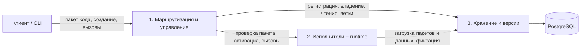

# Архитектура MVP Duro

Duro состоит из трёх серверных модулей: маршрутизация, исполнение и хранение. Между ними используем gRPC, клиенту предоставляем HTTP/JSON API. Языки модулей выбираются независимо, сборки отдельные. Состав MVP задан в [требованиях](Requirements.md).

Разработчик пишет прикладной код, упаковывает его и загружает в Duro. Исполнители получают нужную версию пакета при активации объекта и запускают её в среде исполнения. Прикладной код распространяется независимо от сборки серверов Duro.

Основной путь: `registerType(код, манифест)` → `create(object_id, тип, версия, input)` → `invoke(object_id, метод, argument, request_id)`. Регистрация пакета не создаёт объект; один пакет обслуживает много объектов. Вызов возвращает `{ result, revision }` после фиксации, в том числе `result: null` для метода без возвращаемого значения.

## 1. Маршрутизация и управление объектами

Входной сервер Duro принимает пакеты кода и обращения к объектам. Клиент указывает постоянный `object_id`; модуль определяет, где запустить метод, и организует смену исполнителя после отказа. Долговечные назначения находятся в модуле 3, кеш маршрутов – в памяти этого сервера.

Для реализации нужны:

- **Публичный API:** HTTP/JSON, проверка токена развёртывания, формата и размеров запросов, преобразование внутренних ответов и ошибок.
- **Приём пакетов:** проверка манифеста и хеша, вызов проверки пакета в runtime исполнителя, сохранение пакета и регистрации через модуль 3.
- **Каталог и размещение:** адреса исполнителей из конфигурации, опрос их ID, готовности и поддерживаемого runtime, выбор подходящего процесса и кеш маршрутов. Для первого назначения достаточно round-robin; затем объект остаётся у владельца до отказа.
- **Управление жизненным циклом:** активация объекта, периодические проверки, продление аренды через `Renew` и передача владения через `Acquire`. После истечения прежней аренды модуль назначает другого исполнителя и поручает ему загрузить код и данные.

Модуль общается с исполнителями и хранением через gRPC-клиенты. Вызовы методов направляет владельцу, текущие чтения, историю и ветвление – в модуль 3. Завершённый повтор по `request_id` возвращает до активации объекта и проверки текущей версии кода. Неудачный health-запрос служит поводом проверить доступность; право записи меняется только через протокол владения в хранилище.

После PoC сравниваем размещение по очереди, хешу и нагрузке: задержки, дисбаланс и время восстановления.

## 2. Исполнение объектов

Исполнитель – постоянно работающий процесс, который обслуживает много объектов. Он получает ссылку на зарегистрированный пакет, загружает его через модуль 3, проверяет хеш и кеширует локально. По типу и версии выбирает код, создаёт контекст объекта в runtime и вызывает именованный метод. Новый тип подключается загрузкой пакета, без пересборки или перезапуска исполнителя.

Для реализации нужны:

- **Среда исполнения и загрузчик:** запуск пакета, поиск экспортированных функций, создание и сброс контекстов объектов.
- **API для прикладного кода:** `storage.get/put/delete`, JSON-аргументы, JSON-результат или `null` при отсутствии значения, предметные ошибки и отмена. Асинхронный обработчик ожидается до завершения.
- **Очереди и контексты вызовов:** одна команда объекта за раз, параллельная работа разных объектов, буфер записей и лимиты.
- **Клиент хранения и служебный API:** загрузка пакетов и данных, проверка повторов, фиксация, готовность и поддерживаемый runtime.

Для JavaScript кандидатом служит V8: его можно встроить в сервер и предоставить скриптам функции хоста, включая API Duro. Сам движок выполняет код; очередь, `storage` и протокол фиксации реализует исполнитель. [Документация встраивания V8](https://v8.dev/docs/embed). Конкретный движок и его привязку к языку исполнителя ещё нужно выбрать. Для PoC достаточно одного языка обработчиков и одного формата пакета.

Метод работает с локальными данными и буфером `put/delete`, читая собственные подготовленные записи; отдельный сетевой запрос на каждый доступ к ключу не нужен. После метода исполнитель отправляет записи и результат на фиксацию. Поля экземпляра остаются временными. При отказе, исключении или отмене буфер отбрасывается, экземпляр сбрасывается, поздний результат не фиксируется. Следующая команда получает подтверждённые данные. Лимиты заданы в [NFR-04](requirements/nonfunctional/NFR-04.md).

После PoC исследуем стоимость активации, кеширование экземпляров и влияние очередей горячих объектов на остальные вызовы.

## 3. Хранение и версии

Отдельный gRPC-сервис владеет доступом к PostgreSQL. Он сохраняет код, состояние объектов и служебные данные, проверяет право записи и предоставляет историю. Остальные модули работают с ним через API; прикладной код этот сервис не запускает.

Для реализации нужны:

- **Реестр пакетов:** сохранение кода и манифеста с типом, версией, runtime, точкой входа, методами и хешем; выдача пакета исполнителям.
- **Данные и история:** текущее KV-состояние в JSONB, ревизия, версия кода, `origin` и журнал принятых `put/delete` с версией кода каждой ревизии; чтение текущих и прошлых данных.
- **Фиксация и повторы:** проверка `request_id`, полномочий и ожидаемой ревизии, атомарное сохранение данных, журнала и результата. Успешный метод без записей и предметный отказ сохраняют только результат; записи отказа отбрасываются. Техническая ошибка завершённым прикладным результатом не становится.
- **Владение и доступ к БД:** `Acquire/Renew`, проверка поколения и срока аренды, пул подключений, миграции схемы и SQL-транзакции.

Историческое чтение применяет сохранённые значения и удаления без вызова прикладного кода. Постраничный обход фиксирует верхнюю ревизию по [FR-06](requirements/functional/FR-06.md). `fork` копирует данные выбранной ревизии в новый объект с ревизией `0`, версией кода выбранной ревизии и `origin`. Инициализация и результаты запросов источника не копируются. Создание объекта или ветки сохраняет начальные данные и результат запроса одной транзакцией. Результат отказа инициализации сохраняется без создания объекта.

Для PoC достаточно журнала и полного копирования данных ветки. После PoC сравниваем журнал, периодические снимки и совместное хранение неизменяемых данных: время чтения, восстановления, ветвления и объём хранения.

## Как доставляется код

1. Разработчик собирает пакет с манифестом. Для JavaScript рабочий вариант – один bundle со включёнными зависимостями. Клиентская библиотека или CLI отправляет пакет через `registerType` в модуль 1.
2. Модуль 1 проверяет манифест и хеш, а исполнитель в поддерживаемом runtime проверяет загрузку пакета и наличие объявленных экспортов. Инициализация объекта и RPC-методы при проверке не вызываются.
3. Модуль 3 атомарно сохраняет код и манифест под парой «тип, версия». Хеш проверяется по байтам кода. Повтор с теми же кодом и манифестом возвращает регистрацию, другое содержимое получает `CODE_VERSION_CONFLICT`. Успешный ответ означает, что пакет сохранён и доступен другим исполнителям.
4. При создании или последующей активации исполнитель загружает сохранённый пакет нужной версии. Локальный кеш ускоряет запуск; после отказа другой исполнитель получает тот же код из хранения.

Регистрация новой версии делает её доступной для новых объектов. Код существующего объекта остаётся прежним; обновление с миграцией по FR-10 находится за границами MVP. Сохранённые пакеты нужны также для веток из прошлых ревизий.

## Как выполняется вызов

1. Клиент передаёт `object_id`, `request_id`, имя метода и JSON-аргумент. Модуль 1 проверяет сохранённый результат, затем находит или назначает владельца.
2. Исполнитель ставит вызов в очередь объекта, повторно проверяет результат запроса и загружает подтверждённые данные. При активации получает пакет сохранённой версии. Прикладная инициализация запускается только при создании объекта; восстановление и ветка используют готовые данные.
3. Метод читает данные и готовит записи в локальном `storage`. После завершения обработчика исполнитель сериализует результат, нормализует отсутствие значения в `null` и передаёт в `Commit` записи, результат, исходную ревизию и полномочия. Модуль 3 сохраняет операцию одной транзакцией; при создании используется `CommitCreate` с ревизией `0`.
4. Ответ клиенту возвращается после подтверждения БД. При потере ответа исход выясняется по `request_id`; очередь не продолжает работу на неподтверждённых данных. Клиент повторяет незавершённый запрос с прежними ID и параметрами.

После отказа модуль 1 передаёт владение другому исполнителю. Тот загружает код и данные без повторной инициализации. Незавершённый метод автоматически не перезапускается.

## Владение и контракты

В модуле 3 хранится `(object_id, worker_id, epoch, lease_until)`. ID процесса меняется при перезапуске. `Acquire` назначает нового владельца после истечения аренды и повышает `epoch`; `Renew` продлевает действующее владение. Время берётся из БД. `Acquire`, `Renew` и фиксация блокируют одну запись владения через `SELECT FOR UPDATE`. При фиксации проверяются владелец, поколение, срок и ревизия; блокировка удерживается до завершения транзакции. Прежний владелец не может сохранить поздний результат.

Пара `(object_id, request_id)` уникальна в БД; при `fork` используется целевой ID. Повтор проверяется также внутри транзакции фиксации: те же операция и параметры возвращают прежние ответ и ревизию, другое содержимое получает `REQUEST_ID_CONFLICT`. Это защищает и от одновременных повторов.

Текущие `read` и `describe` читают основную БД через модуль 3: данные и метаданные относятся к одной ревизии. Старый кеш не выдаётся за текущее состояние. RPC без записей тоже фиксирует результат с проверкой владения.

| Граница | Основные операции |
| --- | --- |
| Клиент → модуль 1 | `registerType` с пакетом, `create`, `invoke`, `describe`, `read`, `history`, `readRevision`, `fork` |
| Модуль 1 → модуль 2 | `ValidatePackage`, `Activate`, `Initialize`, `Invoke`, состояние процесса и runtime |
| Модуль 1 → модуль 3 | `RegisterPackage`, `GetRequestResult`, `Acquire`, `Renew`, чтения, история, `Fork` |
| Модуль 2 → модуль 3 | `GetPackage`, `GetRequestResult`, `Load`, `CommitCreate`, `Commit` |

Внутренние интерфейсы закрепляем в общих `.proto` с генерацией клиентов, внешний API – в OpenAPI 3.1. Прикладной JSON передаётся в Protobuf как UTF-8 в полях `bytes`; `worker_id`, `epoch` и ожидаемая ревизия добавляются между модулями. Клиент ожидаемую ревизию не задаёт. Лимит входящего HTTP-запроса не ограничивает ответы и внутренние RPC: их размеры должны вмещать допустимые данные, буфер записей и служебную обёртку по NFR-04. Истечение deadline не доказывает откат; автоматические повторы прикладных RPC отключены. Подробные правила повторов и ошибок находятся в [функциональных требованиях](Functional-Requirements.md#общие-правила).

Модули проверяются независимо: маршрутизатор с заглушками, исполнитель с адаптером хранения, хранение с произвольными KV-данными. Клиентская библиотека, серверный API обработчиков и демонстрационный скрипт относятся к модулю 2.

## Стенд и проверка

Docker Compose запускает маршрутизатор, два исполнителя с runtime, сервис хранения и PostgreSQL 18 с постоянным томом. У БД включены `fsync=on` и `synchronous_commit=on`; успешный ответ означает долговечную фиксацию. Версии образов и зависимостей закреплены. На старте прикладного кода в исполнителях может не быть: CLI загружает пакет после запуска стенда. Пакеты храним в PostgreSQL вместе с метаданными; отдельное хранилище артефактов не требуется. Маршруты и кеши пакетов могут быть восстановлены. Каждый сервис предоставляет `/health/live`, `/health/ready` и JSON-журналы.

Проверки запускаются одной командой: загрузка двух типов без изменения образов, атомарность, конкурентные повторы, предметный отказ, исключение после `put`, поздний результат после таймаута, история и ветка. Отдельно воспроизводим остановки до фиксации и после неё до ответа, восстановление на исполнителе с пустым кешем и запрет записи прежним владельцем ([NFR-09](requirements/nonfunctional/NFR-09.md)). Срок восстановления проверяем изменяющим RPC по [NFR-02](requirements/nonfunctional/NFR-02.md), замеры – по [NFR-05](requirements/nonfunctional/NFR-05.md). История, пакеты и результаты сохраняются до полной очистки стенда ([NFR-03](requirements/nonfunctional/NFR-03.md)). Обоснования из статей остаются в [обзоре литературы](literature/Literature.md).

PoC проверяет отказ исполнителя при доступных API, сервисе хранения и БД; эти три компонента пока единичные. Код поступает от доверенного разработчика. Изоляция недоверенных приложений, CRDT, слияние веток, SQL API объектов, внешние действия, таймеры, обновление кода существующих объектов и высокая доступность БД остаются за границами MVP. Откат по FR-09 – дополнительная операция.
