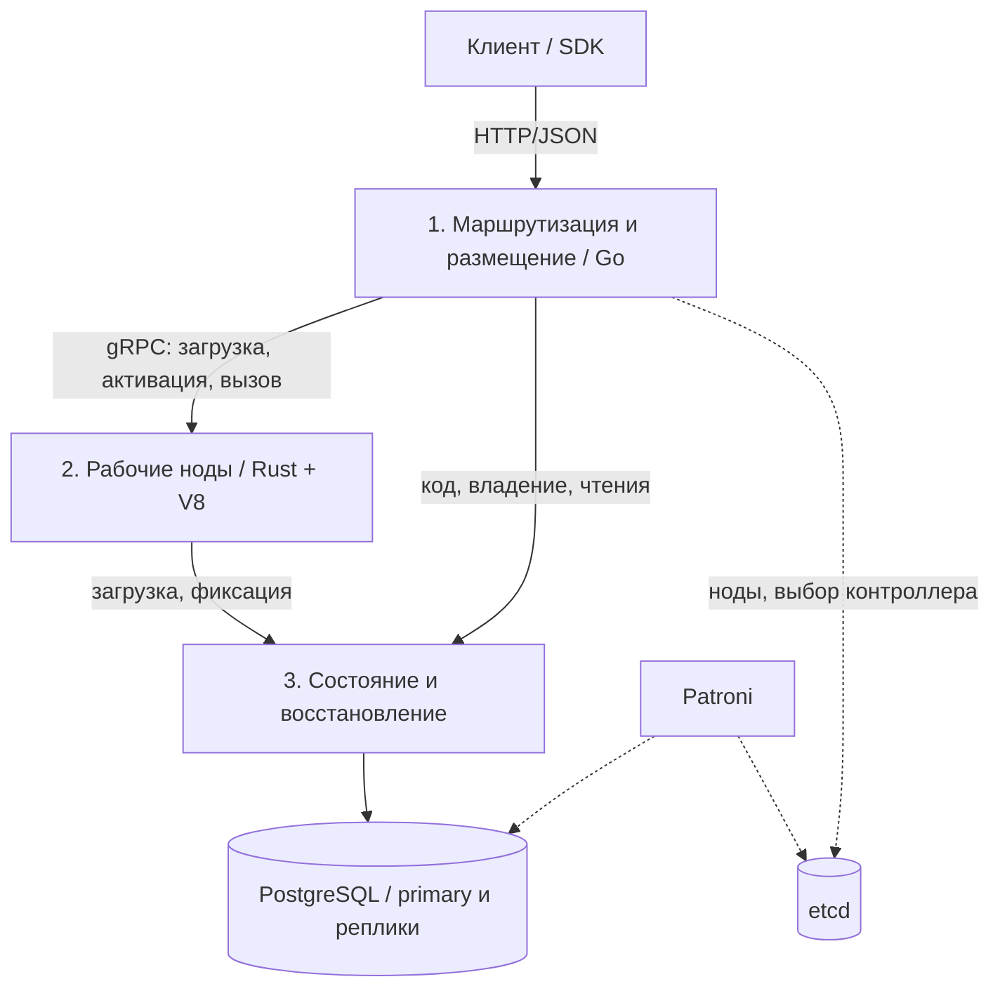

# Архитектура MVP Duro

Duro состоит из трёх разрабатываемых модулей: маршрутизация и размещение, исполнение, состояние и восстановление. Каждый допускает несколько экземпляров. Контракт и приёмка заданы в [требованиях](Requirements.md), стек и модель JavaScript – в [технических решениях](Technical-Decisions.md).

## 1. Маршрутизация и размещение

Модуль принимает запросы, проверяет формат и лимиты, находит владельца объекта и направляет вызов. Клиент работает только с постоянным ID.

Ответственность:

- публичный API и приём пакетов кода;
- состав исполнителей, их доступность и показатели нагрузки;
- кеш маршрутов и обновление после смены владельца;
- размещение по rendezvous hashing и по текущей нагрузке;
- активация, восстановление и перенос между исполнителями;
- выбор объектов для ограниченной ребалансировки.

Выбранный владелец закрепляется в модуле состояния. Хеширование используется для выбора размещения, а не для перенаправления каждого запроса при изменении состава кластера. Смена состава не меняет владение сама по себе: действующие объекты проходят протокол переноса или восстановления.

Маршрутизаторы обслуживают вызовы независимо. Один активный контроллер принимает решения о ребалансировке; его выбор выполняется через etcd. События доступности служат поводом для проверки, но право записи определяется модулем состояния.

## 2. Исполнение объектов

Рабочая нода – Rust-процесс с V8 через `deno_core`. Она обслуживает много объектов, загружает пакеты по типу и версии, кеширует код и подтверждённые данные, предоставляет `ctx.storage`.

Вызовы одного объекта проходят последовательную очередь. Разные объекты обслуживаются параллельно в пределах ресурсов ноды. Нода ограничивает очереди и память, планирует работу между объектами и выгружает неактивные состояния. Количество потоков и устройство isolates определяются архитектурой этого модуля; отдельный процесс или поток на каждый объект не является требованием.

Метод читает локальные данные и подготавливает `put/delete`. Сетевой запрос на каждый доступ к ключу не требуется. Изменения рабочего состояния становятся подтверждёнными только после ответа модуля хранения. При ошибке буфер и изменённый контекст сбрасываются. Следующий вызов получает подтверждённое состояние.

## 3. Состояние и восстановление

Модуль предоставляет gRPC API поверх PostgreSQL. Только он обращается к таблицам Duro.

Он хранит:

- пакеты кода и манифесты;
- ID, тип, версию кода и текущее KV-состояние;
- владельца, поколение и срок аренды;
- входные параметры и завершённые результаты запросов для повторов.

Главная операция – условная атомарная фиксация: проверить полномочия, сохранить изменения и результат. Отдельный публичный журнал истории не нужен. WAL и репликацию обеспечивает PostgreSQL.

Модуль масштабируется несколькими экземплярами сервиса с общим хранилищем. Конкурентные назначения и фиксации согласуются транзакциями БД. Оптимизация записей не должна ослаблять долговечность; схемы KV-таблиц, индексы и пакетная обработка уточняются в его архитектуре.

## Путь вызова

1. Маршрутизатор получает `object_id`, метод, аргумент и `request_id`, использует кеш маршрута или запрашивает назначение.
2. Исполнитель ставит вызов в очередь объекта. Завершённый повтор возвращается без нового запуска обработчика; при необходимости проверяется долговечный результат.
3. Для новой операции нода загружает пакет и состояние, выполняет метод и сериализует результат.
4. Модуль состояния проверяет `request_id`, владельца, поколение и аренду в одной транзакции. Фиксирует записи и ответ.
5. После подтверждения долговечной фиксации нода обновляет локальное состояние и отвечает клиенту.

Неопределённый исход commit разрешается по прежнему `request_id`; работа объекта не продолжается на неподтверждённых данных. Для повтора сохранённого результата при неопределённом commit модуль состояния обязан подтвердить его долговечность, в том числе при переключении БД. Простого чтения локально видимой строки может быть недостаточно. Детальная процедура и проверки относятся к архитектуре хранения.

`read` и `describe` получают текущие данные через модуль состояния с primary БД. Успех чтения не возвращается из неподтверждённого кеша или отстающей реплики. Вызов метода без записей тоже сохраняет результат и проверяет полномочия.

## Владение и восстановление

Назначение содержит `object_id`, `worker_id`, `epoch`, `lease_until`. ID процесса меняется после перезапуска. При выдаче нового владения поколение увеличивается. Проверка поколения и изменение состояния выполняются атомарно в PostgreSQL; это запрещает позднюю запись старого владельца.

После падения ноды контроллер обнаруживает отказ, дожидается допустимого перехода владения и назначает другой исполнитель. Тот загружает закреплённую версию кода и текущие данные. Повторная прикладная инициализация не нужна. SDK повторяет неподтверждённые вызовы с прежними ID, ограничением попыток по общему deadline и задержкой между попытками.

Состояние сохраняется, но незавершённый стек метода не переносится. При недоступности необходимого кворума или хранения система приостанавливает операции, требующие подтверждения.

## Управляемый перенос

Контроллер прекращает выдачу новых вызовов старому владельцу и инициирует завершение текущего метода. После подтверждения его исхода владение меняется, целевая нода загружает данные, маршруты обновляются. Поздние обращения к старой ноде получают служебный ответ о смене владельца и повторяются с тем же `request_id`.

Входящий запрос во время переноса может получить временную недоступность. Долговечное сохранение очереди и перенос выполняющегося V8-контекста не требуются. Если старая нода падает во время переноса, применяется обычное восстановление. Решения о переносе ограничиваются по частоте, чтобы избежать постоянного перемещения объекта.

## Границы модулей

| Граница | Основные операции |
| --- | --- |
| Клиент → маршрутизация | `registerType`, `create`, `invoke`, `describe`, `read` |
| Маршрутизация → исполнитель | Проверка пакета, активация, инициализация, вызов, подготовка переноса, нагрузка |
| Маршрутизация → состояние | Регистрация пакета, получение и смена назначения, продление аренды, чтения |
| Исполнитель → состояние | Получение пакета, загрузка данных, проверка повтора, создание и фиксация |

Названия внутренних RPC и схемы сообщений закрепляются совместно в первую неделю. Прикладные аргументы и значения – JSON; Protobuf описывает транспортную оболочку. API модуля состояния проверяется с произвольными KV-данными, исполнитель – с локальным адаптером хранения, маршрутизация – с заглушками нод.

## Стенд и высокая доступность

Финальный стенд содержит несколько маршрутизаторов и экземпляров сервиса состояния, минимум три рабочие ноды, три PostgreSQL-инстанса с Patroni и три участника etcd. Для сравнения масштабирования число рабочих нод меняется по [NFR-05](requirements/nonfunctional/NFR-05.md).

Сервисы и реплики распределяются минимум по трём VM. Клиент и внутренние соединения должны переключаться на доступный экземпляр или текущий primary; единственный входной процесс не должен блокировать проверку отказа VM. Конкретный способ обнаружения адресов фиксируется в конфигурации стенда.

PostgreSQL работает с долговечной записью и строгой синхронной репликацией. Patroni выполняет автоматическое переключение. Проверяются остановка primary, повтор во время неопределённого commit и сохранность подтверждённых результатов. Граница гарантии – отказ одной VM при доступных остальных узлах и необходимых кворумах. Docker Compose на одном компьютере проверяет отказы процессов, но не заменяет этот сценарий.

## Этапы

| Этап | Результат |
| --- | --- |
| 1 | Общие контракты, runtime V8 со Storage API, первый вызов через три модуля; зафиксирован план нагрузочных измерений |
| 2 | Несколько исполнителей, владение, повторы и восстановление; интеграция HA-хранения |
| 3 | Две политики размещения, перенос, ограниченные очереди и нагрузочные прогоны |
| 4 | Отказы под нагрузкой, сравнение результатов, устранение узких мест, демо и отчёт |

Проверки корректности и производительности идут вместе с разработкой. Подробные структуры данных и алгоритмы модулей описываются при их реализации.
