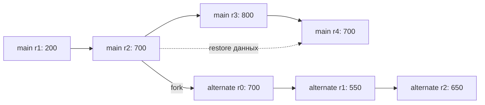

# История, ветки и откат

Историческое чтение, создание ветки и откат используют выбранную ревизию данных, но меняют разные вещи.

Историческое чтение и ветка обязательны для PoC. Откат является дополнительной операцией.

Примеры используют синтаксис JavaScript; сигнатуры SDK предварительные.

| Операция | ID объекта | Что происходит с текущими данными |
| --- | --- | --- |
| `readRevision(revision)` | Исходный | Возвращается прошлое содержимое хранилища; текущая версия сохраняется |
| `fork(revision)` | Новый | Создаётся независимое продолжение выбранной версии |
| `restore(revision)` | Исходный | Прошлые данные принимаются как новая ревизия |

## История хранилища

История состоит из начальных данных на ревизии `0` и журнала подтверждённых записей. Для получения версии Duro применяет сохранённые значения и удаления до выбранной границы.

Прикладные методы заново не вызываются. Изменение кода проверки бюджета не должно менять данные уже записанной ревизии.

Просмотр истории возвращает группы изменений:

```javascript
await duro.history(object_id, { limit: 50 });
// → { entries: [{ revision: 0, changes: [...] }, ...], cursor: null }
```

Журнал описывает то, что записано через `storage`. Он не восстанавливает причину операции, автора или внешние сведения, если приложение их не сохранило.

Ревизия обозначает целиком принятую запись команды. Историческое чтение промежуточного `put` внутри метода не предусмотрено.

## Чтение прошлой версии

В [примере поездки](Concepts-Trip.md) `trip/main@2` содержит дорогу за 200 и жильё за 500. Следующая команда добавляет занятие за 100 и создаёт ревизию 3.

`readRevision("trip/main", 2)` возвращает данные на 700. Текущий план остаётся на ревизии 3 с итогом 800.

Пока используем явные номера ревизий. Чтение по времени требует отдельного определения часов и границы фиксации. Одинаковые номера у разных объектов не образуют общий исторический срез.

## Ветка

```javascript
await duro.fork({
    source_object_id: "trip/main",
    source_revision: 2,
    target_object_id: "trip/alternate",
    request_id: "fork-alternate",
});
// → { object_id: "trip/alternate", revision: 0 }
```

Duro восстанавливает указанное содержимое хранилища. Новый объект получает эти данные, тип и версию кода выбранной ревизии, а также происхождение `origin`. Текущая версия кода источника может отличаться; для ветки нужен зарегистрированный пакет исходной версии. Собственная нумерация начинается с `0`.

Для первого варианта предлагаем хранить у ветки собственные начальные данные. Доступ к её текущей версии не требует восстановления источника. Предыстория остаётся у исходного объекта; ссылка `origin` позволяет найти её, пока она доступна.

Источник может продолжить работу во время создания ветки. Результат всё равно должен соответствовать указанной ревизии. Если она недоступна, операция завершается ошибкой.

Клиент выбирает ID ветки до отправки запроса. Повтор завершённого создания с теми же параметрами возвращает прежний объект. Другой запрос на занятый ID означает конфликт.

## Откат с сохранением истории

Для отката предлагаем операцию:

```javascript
await duro.restore("trip/main", {
    source_revision: 2,
    request_id: "restore-main",
});
// → { object_id: "trip/main", revision: 4 }
```

Duro берёт полный набор пользовательских данных выбранной версии и принимает его как новое изменение. Версия кода выбранной ревизии должна совпадать с текущей; иначе можно создать независимую ветку, но откат данных не выполняется. Ключи, появившиеся позже, также должны исчезнуть из текущего содержимого. Прежние ревизии остаются доступными в пределах принятой политики хранения.



Числа показывают итог расходов в условных единицах. Стрелка `restore` указывает источник данных новой ревизии. Исходная история сохраняется.

Откат распространяется только на пользовательские данные. ID объекта, версия кода, текущее владение и записи результатов запросов остаются прежними. Ветки продолжают собственную историю.

Операция должна сохранять достаточно данных для дальнейшего восстановления. Одной ссылки на старую ревизию недостаточно, если её затем разрешат удалить. Полный образ или воспроизводимый набор изменений предстоит выбрать в RFC.

## Повторы после отката

Результаты запросов хранятся вне откатываемых пользовательских данных. Иначе запоздавший повтор прежней команды мог бы снова применить изменение, которое пользователь отменил откатом.

В примере повтор запроса, создавшего ревизию 3, вернёт его старый результат. Текущие данные останутся на ревизии 4. Новое добавление занятия требует нового ID запроса.

Откат заменяет данные, актуальные на момент его очереди, без проверки ревизии со стороны клиента. Повтор с тем же `request_id` возвращает результат прежнего отката без новой ревизии; это соответствует общему [контракту команд](Concepts-Commands.md).

## Снимки и стоимость

Для исторического чтения Duro может загрузить логический снимок хранимых данных и применить последующий журнал. Снимки не содержат память процесса или стек метода.

Копирование данных при `fork` и `restore` допустимо как первый вариант. Стоимость зависит от размера хранилища. Общая неизменяемая история и более дешёвое ветвление имеют смысл после измерений.

В PoC старые ревизии сохраняются до полной очистки развёртывания по [NFR-03](../requirements/nonfunctional/NFR-03.md). Удаление отдельных ревизий отложено; при его добавлении потребуется определить судьбу исторических ссылок.

## Границы операций

Ветки не обмениваются изменениями с оригиналом. Слияние требует правил приложения. Реплика представляет тот же логический объект и имеет другой контракт синхронизации.

Ссылки на самостоятельные объекты остаются ссылками: `fork` не копирует граф объектов. Внешние действия тоже остаются совершёнными. Возврат данных плана к старой версии не отменил бы покупку билета, если бы приложение выполняло такие операции.

После отката или переключения хранимых данных рабочие кеши экземпляра нужно сбросить или пересоздать. Их содержимое не должно подменять новую подтверждённую версию.
