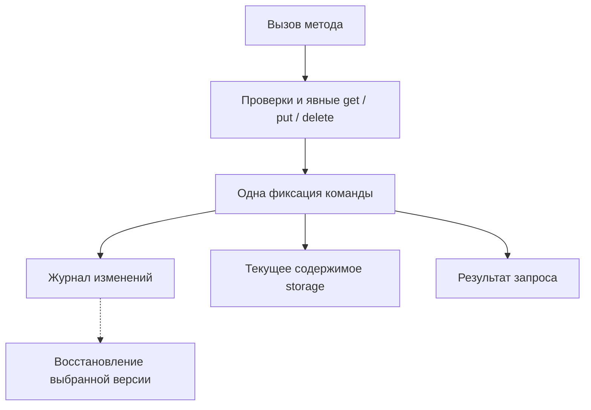

# Хранение и журнал изменений

Разработчик объекта явно сохраняет данные через `storage`. Duro отвечает за фиксацию этих записей и доступ к их истории.

В качестве отправной точки используем принцип Cloudflare Durable Objects: у объекта есть собственное хранилище, а данные в обычных переменных живут до выгрузки экземпляра. Для сохранения после перезапуска Cloudflare требует обращаться к Storage API. [Документация Cloudflare](https://developers.cloudflare.com/durable-objects/best-practices/access-durable-objects-storage/).

Совместимость со всем API Cloudflare не предполагается. Граница транзакции и KV-интерфейс Duro заданы в [общих правилах](../Functional-Requirements.md#общие-правила).

## Явные операции

В MVP доступны только операции key-value хранилища:

```text
storage.get(key)        -> сохранённое значение или отсутствие значения
storage.put(key, value) -> подготовить запись значения
storage.delete(key)    -> подготовить удаление ключа
```

Ключи – строки, значения – JSON. Лимиты заданы в [нефункциональных требованиях](../Nonfunctional-Requirements.md). Изменение локальной переменной или значения, полученного через `get`, не заменяет `put`.

Эскиз метода объекта на JavaScript. `DomainError` обозначает предметный отказ; обычное исключение считается внутренней ошибкой:

```javascript
function addExpense(ctx, expense) {
    const budget = ctx.storage.get("budget");
    const expenses = ctx.storage.get("expenses");

    if (Object.hasOwn(expenses, expense.id)) {
        throw new DomainError("Позиция уже существует");
    }

    const total = Object.values(expenses)
        .reduce((sum, item) => sum + item.amount, 0);

    if (total + expense.amount > budget) {
        throw new DomainError("Превышен бюджет");
    }

    expenses[expense.id] = expense;
    ctx.storage.put("expenses", expenses);

    return { total: total + expense.amount };
}
```

Метод выбирает, что прочитать и сохранить. В примере разработчик записывает целиком значение ключа `expenses`. Duro не обязана выделять из него отдельное предметное событие или вычислять разницу между полями.

## Граница фиксации

Предлагаем выполнять один изменяющий вызов объекта в одной транзакционной области. Записи `put` и `delete` подготавливаются до успешного завершения метода. Чтения внутри вызова видят его собственные подготовленные записи.

После завершения метода Duro принимает изменения, результат запроса и новую ревизию как одну операцию. История содержит версию кода на каждой ревизии. При обновлении кода вместе с результатом `migrate` сохраняется новая версия. Успешный `put` внутри метода означает подготовленную запись; клиент получает подтверждение после фиксации всей операции.

При предметном отказе записи команды отбрасываются. Результат отказа сохраняется для повторов без новой ревизии пользовательских данных. Технический сбой и неопределённый исход фиксации разбираются через подтверждённые данные и ID запроса.



Три нижние записи входят в одну логическую фиксацию. Схема показывает данные, которые сохраняет модуль хранения одной транзакцией. Разделение на сервисы и проверки фиксации описаны в [архитектуре MVP](../Architecture-MVP.md).

## События уровня хранилища

Журнал должен содержать принятые изменения с достаточными данными для воспроизведения. Например:

```text
revision=2
changes=[
    put("expenses", {
        train: {amount: 200},
        hotel: {amount: 500}
    })
]
```

При восстановлении Duro применяет сохранённые значения и удаления. Прикладной метод `addExpense` заново не вызывается. Поэтому история не зависит от повторного расчёта старого метода или повторного обращения к внешнему сервису.

Начальные данные и журнал составляют основание для восстановления версий. Текущее содержимое `storage` представляет их материализованное состояние. Запись текущих значений в обход журнала нарушила бы этот контракт.

Физический WAL выбранной БД имеет собственное назначение. Для публичных ревизий Duro нужен определённый логический формат истории и правила её хранения.

## Предметный Event Sourcing

Событие `ExpenseAdded` сообщает смысл операции. Запись `put("expenses", value)` сообщает новое значение ключа. По одной записи нельзя достоверно определить причину изменения или намерение пользователя.

В классической событийной модели разработчик задаёт предметные события и способ их применения. Ранее предложенный контракт `handle(state, command) → events`, `apply(state, event) → state` относился к этому варианту.

Для модели с явным `storage` обязательный прикладной обработчик `apply` не нужен. Восстановление записей выполняет платформа. Если приложению нужны автор, причина или предметное название операции, эти сведения надо сохранять дополнительно.

Интерфейс добавления метаданных и возможность отдельного режима предметного Event Sourcing остаются открытыми.

## Снимки данных

Логический снимок содержит значения хранилища на известной ревизии. Duro может загрузить его и применить последующие изменения журнала.

Это оптимизация восстановления. Она не требует сохранять память процесса, стек вызовов или произвольные поля класса. Приложение по-прежнему явно выбирает долговечные данные через `storage`.

Для небольшого журнала достаточно начальных данных и последовательного воспроизведения. Периодичность снимков стоит выбирать после измерений.

## Открытые вопросы SQL API

В Cloudflare доступны SQL и KV. В MVP Duro прикладному коду доступен только KV API. SQL API находится за пределами MVP.

Записывать SQL-текст и повторять его позднее недостаточно для общего восстановления: выражения времени, случайность и другая среда выполнения могут дать иной результат. Такие функции описаны в [документации SQLite](https://sqlite.org/deterministic.html). Для SQL потребуется определить захват фактических изменений данных, версионирование схемы и правила воспроизведения.

Контракт KV API не зависит от внутренней БД. Для PoC в архитектуре выбран PostgreSQL 18, который используется только модулем хранения. Собственный движок БД и автоматическое сохранение памяти объекта не нужны для этого контракта.
