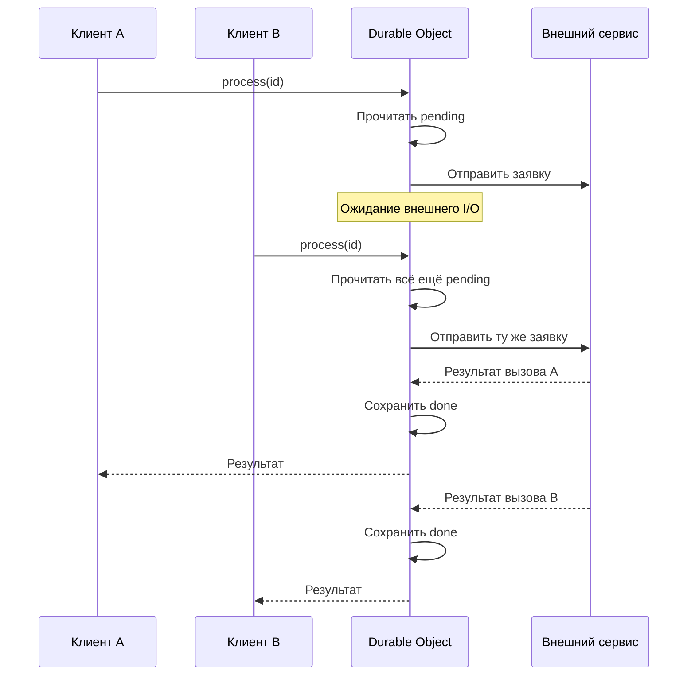
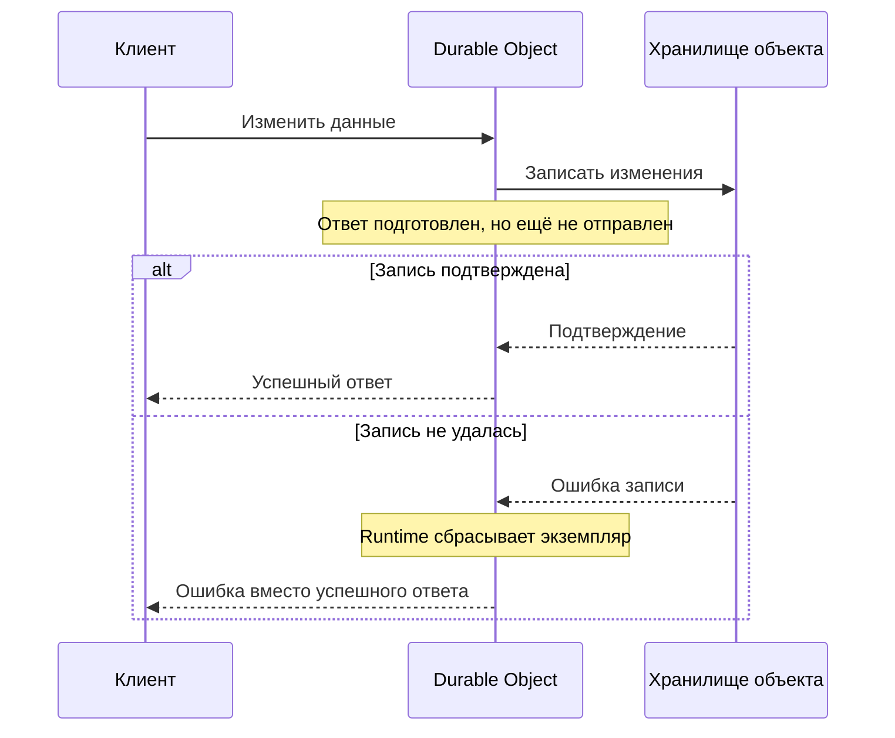
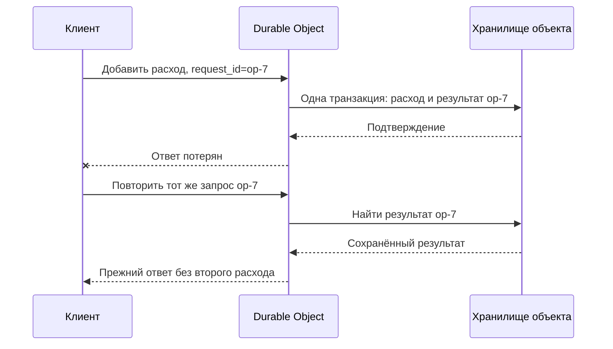

# Конкурентность и гарантии Durable Objects

Один DO выполняет JavaScript в одном потоке. Несколько асинхронных обработчиков могут чередоваться, хотя синхронный код каждого из них работает без вмешательства других обработчиков. Порядок доставки вызовов, атомарность записей и завершение всей прикладной операции имеют разные гарантии [[1]](#source-1).

## Асинхронное выполнение и гонки

Пока обработчик выполняет синхронный код, другой обработчик не меняет его состояние. Ожидание внешнего I/O, например `await fetch(...)`, позволяет runtime обработать другие события. Проверка, сделанная до ожидания, к моменту продолжения может устареть [[2]](#source-2).

Пусть в storage есть заявка со статусом `pending`. Такой обработчик может отправить её дважды:

```javascript
async function process(id) {
    const item = await storage.get(id);
    if (item.status === "pending") {
        const result = await sendToExternalService(id);
        await storage.put(id, { status: "done", result });
    }
}
```

`sendToExternalService` здесь означает HTTP-вызов приложения. Во время его ожидания другой запрос может прочитать прежний статус:



Для такого метода приложению понадобятся промежуточное состояние, правила повторов и способ согласования с внешним сервисом.

## Input gates и output gates

Runtime добавляет правила на границах ввода и вывода:

| Механизм | Что обеспечивает |
| --- | --- |
| Input gate | Во время операций storage задерживает доставку других событий. Это защищает обычные последовательности чтения и записи через асинхронный Storage API |
| Output gate | Задерживает исходящие сетевые сообщения до подтверждения предшествующих записей. Если запись не удалась, результат не выдаётся как успешный, а объект перезапускается |

Благодаря gates прикладной код может продолжать работу, пока запись получает подтверждение. Если приложение само запускает операции параллельно, возможны конфликты: два вызова функции без ожидания первого могут вмешаться в работу друг друга внутри одного события [[1]](#source-1).

Output gate удерживает подготовленный ответ до подтверждения записи:



Эта защита относится к исходящим сообщениям после записи. Если HTTP-вызов уже был выполнен до неё, output gate его не отменит.

У асинхронного KV API есть опции, ослабляющие стандартную защиту: `allowConcurrency` допускает конкурентность при чтении, `allowUnconfirmed` разрешает исходящий трафик до подтверждения записи. При их использовании приложение само должно учитывать эти ситуации [[3]](#source-3).

## Границы транзакции

Синхронные SQL-операции не передают управление циклу событий между вызовами. Storage API также автоматически объединяет подходящие последовательности записей. Для явной синхронной транзакции есть `transactionSync(callback)`: исключение из callback откатывает её записи; callback не может быть `async` [[4]](#source-4).

Если метод записал состояние, дождался внешнего сервиса, затем сделал ещё одну запись, первая запись к этому моменту уже могла получить подтверждение. Целый метод не обязательно входит в одну транзакцию. Приложению нужно определить, какие записи откатываются при предметном отказе.

`blockConcurrencyWhile(...)` запрещает доставку других событий на время callback, включая ожидания внешнего I/O. Обычно его применяют для инициализации. Длительный callback блокирует весь объект. Через 30 секунд срабатывает таймаут, после которого объект сбрасывается. Метод ограничивает конкурентность внутри DO; для транзакции с внешним сервисом всё ещё нужен отдельный протокол [[5]](#source-5).

## Порядок доставки и завершения вызовов

Вызовы через один stub доставляются объекту в порядке отправки. Эта гарантия называется E-order и не действует между разными stubs. Асинхронные методы могут завершиться в другом порядке [[6]](#source-6).


## Повторные запросы и дедупликация

Ответ может потеряться после сохранения данных. Клиент не знает, применилась ли команда и безопасно ли её повторить.

Для команды «добавить расход» приложение может хранить ID операции и её результат в той же транзакции, что и расход. Тогда повтор с тем же ID вернёт прежний результат. Приложение реализует такую дедупликацию и выбирает срок хранения результатов.



Схема показывает прикладную реализацию поверх транзакции storage. При повторе приложение проверяет, что ID относится к тем же параметрам команды. Для нового намерения, даже с такой же суммой, клиент выбирает новый ID.

Cloudflare рекомендует повторять ошибки с `.retryable` только для идемпотентных запросов и увеличивать задержку между попытками по экспоненте. Ошибки `.overloaded` повторять не следует: это усиливает перегрузку. После исключения может потребоваться новый stub [[7]](#source-7).

## Таймеры и внешние операции

У объекта может быть один установленный alarm. Runtime запускает обработчик даже без клиентского запроса. Исполнение имеет семантику at least once: обработчик может повториться. При исключении runtime делает не более шести автоматических повторов с увеличением задержки; для дальнейших попыток приложение должно запланировать работу заново [[8]](#source-8).

Транзакция storage не охватывает отправку письма или вызов чужого HTTP API. Для связи записи с доставкой можно применить outbox. Данные и намерение отправки сохраняются вместе, затем отдельный обработчик отправляет сообщение и отмечает результат. Получатель должен учитывать возможные дубликаты. Этот паттерн распределённых систем можно реализовать поверх DO [[9]](#source-9).

Атомарность нескольких объектов также не возникает из обычной цепочки RPC. Если перевод меняет два независимых хранилища, приложению нужен отдельный протокол. Границы такого разбиения разобраны в [ограничениях](Durable-Objects-Limitations.md).

## Литература

<a id="source-1"></a>

[1] Kenton Varda. [Durable Objects: Easy, Fast, Correct – Choose three](https://blog.cloudflare.com/durable-objects-easy-fast-correct-choose-three/). Cloudflare Blog, 3 августа 2021 года.

<a id="source-2"></a>

[2] Cloudflare. [Rules of Durable Objects](https://developers.cloudflare.com/durable-objects/best-practices/rules-of-durable-objects/). Документация.

<a id="source-3"></a>

[3] Cloudflare. [SQLite-backed Durable Object Storage](https://developers.cloudflare.com/durable-objects/api/sqlite-storage-api/). Документация.

<a id="source-4"></a>

[4] Cloudflare. [SQLite-backed Durable Object Storage: transactionSync](https://developers.cloudflare.com/durable-objects/api/sqlite-storage-api/#transactionsync). Документация.

<a id="source-5"></a>

[5] Cloudflare. [Durable Object State: blockConcurrencyWhile](https://developers.cloudflare.com/durable-objects/api/state/#blockconcurrencywhile). Документация.

<a id="source-6"></a>

[6] Cloudflare. [Durable Object Stub](https://developers.cloudflare.com/durable-objects/api/stub/). Документация.

<a id="source-7"></a>

[7] Cloudflare. [Error handling](https://developers.cloudflare.com/durable-objects/best-practices/error-handling/). Документация.

<a id="source-8"></a>

[8] Cloudflare. [Alarms](https://developers.cloudflare.com/durable-objects/api/alarms/). Документация.

<a id="source-9"></a>

[9] AWS. [Transactional outbox pattern](https://docs.aws.amazon.com/prescriptive-guidance/latest/cloud-design-patterns/transactional-outbox.html). AWS Prescriptive Guidance.
