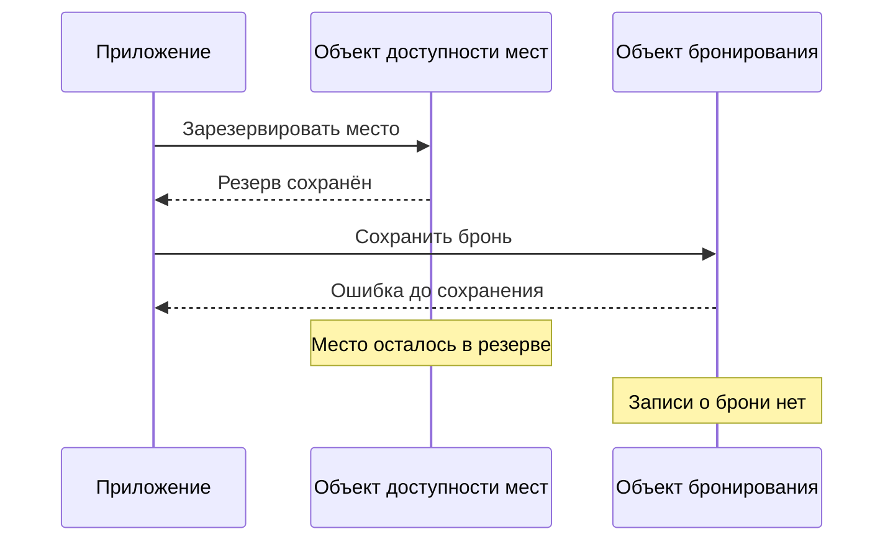

# Проблемы и ограничения Durable Objects

Платформа адресует объекты, запускает исполнителей и сохраняет данные. Разработчик приложения выбирает границы объектов, согласует внешние действия и решает, как обрабатывать перегрузку. От этих решений зависят пределы нагрузки и поведение приложения при сбоях.

## Нагрузка на один объект

Масштабирование происходит за счёт множества объектов. Один объект остаётся однопоточным; увеличение их общего числа не ускоряет конкретный популярный документ или глобальный счётчик. Cloudflare указывает мягкий ориентир около 1000 запросов в секунду на объект, но реальная пропускная способность зависит от работы обработчика. При перегрузке runtime сначала ставит запросы в очередь, затем возвращает ошибку [[1]](#source-1).

Для своего сценария нужно измерять обработку сообщений, размер данных, рассылку и задержку при пике нагрузки. Обновление большой доски может потребовать больше работы, чем короткое изменение счётчика, поэтому указанное число нельзя переносить на любое приложение.

При разбиении популярной сущности на несколько объектов придётся согласовывать их состояние. Несколько локальных счётчиков можно суммировать, но для строгого общего лимита потребуется протокол принятия решений между объектами.

## Размещение и задержка запросов

Запрос направляется в место исполнения объекта. Для удалённого клиента это может быть дополнительный сетевой путь. Один общий объект не может одновременно находиться рядом со всеми участниками, распределёнными по миру.

По текущей документации место размещения существующего DO автоматически не меняется вслед за аудиторией. Начальное размещение можно направить через `locationHint`, но это пожелание без гарантии конкретного места. Ограничение юрисдикции имеет другой смысл: задаёт регион исполнения и хранения [[2]](#source-2).

К задержке локального SQL-запроса добавляются путь от клиента через Worker к объекту и обращения объекта к внешним сервисам.

## Операции над несколькими объектами

У каждого объекта своё приватное хранилище. Чтобы выполнять запросы и транзакции над данными нескольких объектов, приложению потребуется дополнительная логика. Общей БД у этих объектов нет [[3]](#source-3).

Например, один объект может принять бронь, а другой изменить остаток общего лимита. Сбой между двумя вызовами оставит промежуточный результат. Нужно либо собрать инвариант в одной границе, либо определить протокол, который учитывает частичное завершение.

Например, приложение разнесло учёт свободных мест и записи о бронировании в разные объекты:

Откат транзакции во втором объекте не отменяет подтверждённую запись в первом. Протокол приложения должен обработать это частичное завершение, например повторить вторую операцию или освободить резерв.

Отчёты по всем комнатам также требуют отдельной организации чтения: обход объектов, индекс или проекция в другом хранилище. Если такая проекция обновляется асинхронно, нужно определить её допустимое отставание.

## Сбои и смена экземпляра

После сбоя объект восстанавливает сохранённые данные, но не продолжает прерванный метод с места остановки. Если потерян ответ, клиент может не знать исход команды. Подробнее о повторах и внешних действиях на странице [конкурентности и гарантий](Durable-Objects-Coordination.md).

Cloudflare проверяет актуальность экземпляра при начале события и обращении к storage. Долго работающий обработчик без обращений к хранилищу может не заметить, что его уже заменили другим экземпляром, и продолжить вычисления или внешнее действие. Попытка доступа к storage выявит замену [[4]](#source-4).

При интеграции с внешними системами нужны собственные ID операций и защита от повторов на стороне получателя.

## Обновления кода и схемы

Во время развёртывания Worker и DO могут некоторое время исполнять разные версии кода. Cloudflare рекомендует сохранять совместимость их API в обе стороны [[5]](#source-5).

Приложение также версионирует данные и мигрирует свою схему. API управления классами позволяет создавать, переименовывать и переносить namespace; преобразование предметных записей внутри БД остаётся задачей приложения [[6]](#source-6).

Для чтения прошлых данных может потребоваться прежняя интерпретация схемы. Откат содержимого БД не откатывает код.

## Лимиты ресурсов

Лимиты DO с SQLite на платформе Cloudflare, по документации на 22 октября 2026 года:

| Ресурс | Документированный лимит |
| --- | --- |
| Хранилище объекта на Workers Paid | 10 GB |
| Общее хранилище аккаунта на Workers Free | 5 GB |
| Размер KV ключа и значения вместе | 2 MB |
| Максимальный размер строки таблицы или BLOB | 2 MB |
| CPU на вызов | По умолчанию 30 секунд; можно настроить до 5 минут |

CPU time учитывает активное выполнение кода, без ожидания I/O. Эти ограничения задают пределы ресурсов; пропускную способность конкретного объекта проверяют под нагрузкой. Перед проектированием стоит сверить действующие лимиты и условия тарифа [[7]](#source-7).

## Стоимость и переносимость

В стоимости участвуют обращения к DO, длительность его активности, операции хранения и объём данных. Duration учитывает и время ожидания, когда объект остаётся активным и не может перейти в спящий режим. Для SQLite чтения и записи тарифицируются по строкам; KV-операции поверх SQLite также участвуют в этой модели [[8]](#source-8).

При оценке стоимости нужно считать частоту сообщений, записи на каждое изменение и время с открытыми соединениями. Одного числа HTTP-запросов для расчёта не хватит. Hibernation уменьшает duration для подходящих WebSocket-сценариев; обработка и хранение продолжают тарифицироваться.

Storage API, stubs, alarms и hibernation привязаны к платформенному интерфейсу. При переносе приложения в другой runtime потребуется воспроизвести их поведение. Объём работы зависит от того, насколько предметная логика использует эти механизмы напрямую.

Далее: [сравнение с Duro](Durable-Objects-and-Duro.md).

## Литература

[1] Cloudflare. [FAQs: How much work can a single Durable Object do?](https://developers.cloudflare.com/durable-objects/reference/faq/#how-much-work-can-a-single-durable-object-do). Документация.

[2] Cloudflare. [Data location](https://developers.cloudflare.com/durable-objects/reference/data-location/). Документация.

[3] Kenton Varda. [Workers Durable Objects Beta: A New Approach to Stateful Serverless](https://blog.cloudflare.com/introducing-workers-durable-objects/). Cloudflare Blog, 28 сентября 2020 года.

[4] Cloudflare. [Known issues: Global uniqueness](https://developers.cloudflare.com/durable-objects/platform/known-issues/#global-uniqueness). Документация.

[5] Cloudflare. [Known issues: Code updates](https://developers.cloudflare.com/durable-objects/platform/known-issues/#code-updates). Документация.

[6] Cloudflare. [Durable Object class exports](https://developers.cloudflare.com/durable-objects/reference/durable-objects-migrations/). Документация.

[7] Cloudflare. [Limits](https://developers.cloudflare.com/durable-objects/platform/limits/). Документация.

[8] Cloudflare. [Pricing](https://developers.cloudflare.com/durable-objects/platform/pricing/). Документация.
