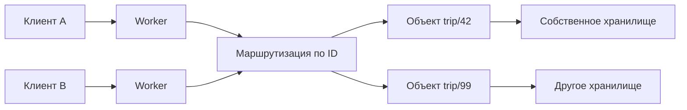
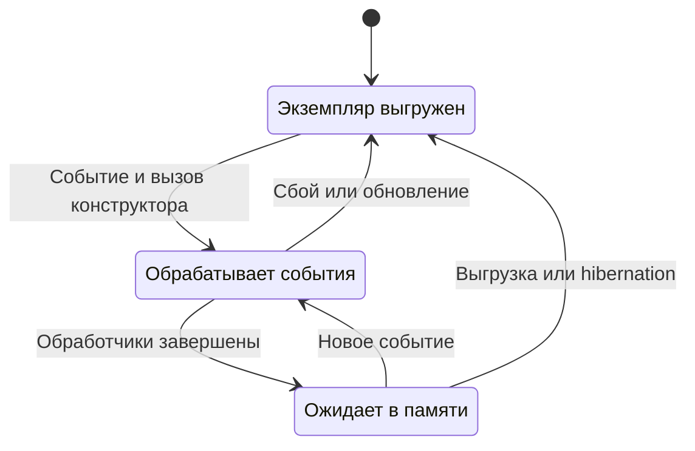

# Модель и жизненный цикл Durable Objects

Клиент обращается к Durable Object по постоянному ID. Платформа находит активный экземпляр или запускает новый. После перезапуска экземпляр получает доступ к сохранённым данным того же объекта [[1]](#source-1).

## Класс, пространство имён и ID

| Термин | Значение |
| --- | --- |
| Класс | Прикладной код с методами объекта |
| Пространство имён, namespace | Набор объектов, доступный через настроенную привязку Worker |
| ID | Постоянный идентификатор объекта |
| Имя | Строка, из которой можно получить устойчивый ID в пространстве имён |
| Stub | Клиентская ссылка для удалённых вызовов объекта |

Например, `env.PLANS.getByName("trip/42")` возвращает stub плана, через который Worker вызывает его методы. По одинаковому имени в одном namespace разные запросы находят один объект. В другом namespace та же строка может обозначать другой объект. API также позволяет сгенерировать новый уникальный ID [[2]](#source-2).

Само получение stub ещё не запускает прикладной экземпляр. Его жизненный цикл начинается с вызова метода через stub [[3]](#source-3).

## Маршрутизация запросов

Worker принимает внешний запрос и выбирает объект. Вызов может быть RPC-вызовом метода или обращением к HTTP-обработчику `fetch`. Браузер работает через внешний интерфейс приложения; stub относится к API Workers [[4]](#source-4).

Перед вызовом приложение проверяет, вправе ли клиент читать или менять план `trip/42`. Само знание ID не даёт пользователю этих прав.

## Выбор границы объекта

Cloudflare предлагает выбирать объект по минимальной логической единице, внутри которой требуется координация: документ, игровая сессия, комната, пользователь или рабочее пространство. Один общий объект на всё приложение мешает параллельной обработке независимых сущностей [[5]](#source-5).

Для плана поездки выбор может выглядеть так:

- Один объект на план позволяет вместе проверять бюджет и менять расходы.
- Один объект на расход разделяет данные, участвующие в общей проверке бюджета. Согласование придётся организовать между объектами.
- Один объект на все поездки связывает обработку независимых планов и собирает их нагрузку в одном месте.

Вложенная запись может иметь собственный ID и оставаться частью объекта плана.

## Состояния и перезапуск экземпляра

При первом событии runtime вызывает конструктор, затем обработчик. После завершения запросов экземпляр может оставаться в памяти, перейти в спящий режим или быть выгружен. Если к выгруженному объекту придёт новое событие, платформа создаст экземпляр заново [[3]](#source-3).

Схема упрощена до основных состояний. После выгрузки у объекта сохраняются ID и подтверждённые записи storage, но новый экземпляр заново создаёт рабочую память [[3]](#source-3), [[6]](#source-6).

Поля экземпляра подходят для кешей и временных структур. При выгрузке они теряются. Значения, необходимые следующему экземпляру, приложение записывает в storage и затем загружает оттуда. Глобальные переменные модуля опасны для состояния сущности: разные объекты могут разделять одну глобальную память [[6]](#source-6).

Конструктор может выполняться много раз за жизнь одного ID. При инициализации нужно проверять существующие данные: создание начального состояния и загрузка сохранённого объекта требуют разных действий.

## WebSocket и hibernation

WebSocket Hibernation API позволяет выгрузить экземпляр и сохранить клиентские соединения в сети Cloudflare. Следующее сообщение снова запускает экземпляр и вызывает обработчик. Память процесса, включая обычные поля, теряется. Небольшие сведения о соединении можно восстановить из attachment, а долговечные данные загрузить из storage [[7]](#source-7).

Далее: [хранение и восстановление](Durable-Objects-Storage.md), [конкурентность и гарантии](Durable-Objects-Coordination.md).

## Литература

[1] Cloudflare. [What are Durable Objects?](https://developers.cloudflare.com/durable-objects/concepts/what-are-durable-objects/). Документация.

[2] Cloudflare. [Durable Object Namespace](https://developers.cloudflare.com/durable-objects/api/namespace/). Документация.

[3] Cloudflare. [Lifecycle of a Durable Object](https://developers.cloudflare.com/durable-objects/concepts/durable-object-lifecycle/). Документация.

[4] Cloudflare. [Invoke methods](https://developers.cloudflare.com/durable-objects/best-practices/create-durable-object-stubs-and-send-requests/). Документация.

[5] Cloudflare. [Rules of Durable Objects](https://developers.cloudflare.com/durable-objects/best-practices/rules-of-durable-objects/). Документация.

[6] Cloudflare. [In-memory state in a Durable Object](https://developers.cloudflare.com/durable-objects/reference/in-memory-state/). Документация.

[7] Cloudflare. [Use WebSockets](https://developers.cloudflare.com/durable-objects/best-practices/websockets/). Документация.
