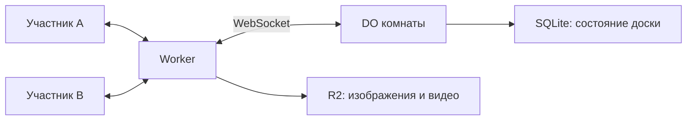
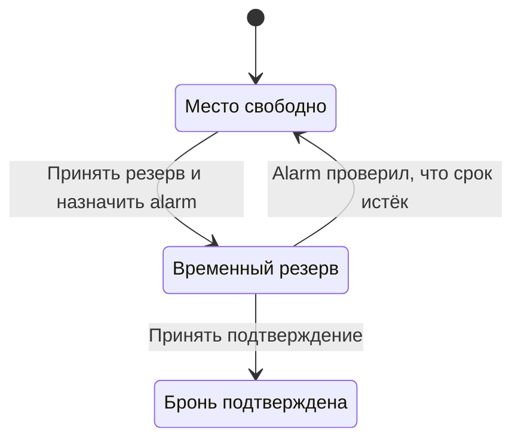

# Сценарии применения Durable Objects

DO подходит для приложений с множеством независимых сущностей, внутри которых клиенты работают с общим состоянием. Граница объекта зависит от того, какие данные и решения нужно собрать у одного исполнителя [[1]](#source-1).

## Примеры разбиения приложения

В каждом из этих вариантов приложение задаёт предметные правила и обрабатывает ошибки.

| Сценарий | Один объект | Что он координирует | Что нужно определить приложению |
| --- | --- | --- | --- |
| Совместный документ | Документ или доска | Изменения и рассылку обновлений участникам | Конфликты правок, права доступа, историю и работу без связи |
| Чат | Комната | Сообщения, подключённых участников и рассылку | Доставку после переподключения и срок хранения сообщений |
| Многопользовательская игра | Матч | Ходы и текущее состояние игры | Проверку действий и допустимую задержку |
| Бронирование | Рейс или другая ограниченная группа ресурсов | Проверку занятости и принятие брони | Срок резервирования и согласование с внешней оплатой |
| Лимитирование запросов | Ключ лимита, например клиент | Изменение общего счётчика | Окно лимита, повторы и поведение при недоступности |
| Фоновая обработка | Сущность с собственной очередью | Накопление работы и запуск через alarm | Идемпотентность, дальнейшие попытки и необработанные ошибки |

Cloudflare приводит комнаты, документы и игровые сессии среди примеров в исходной публикации [[2]](#source-2). Статья об alarms описывает отложенную обработку и накопление запросов перед отправкой [[3]](#source-3).

## Архитектура tldraw sync

tldraw использует DO как уникальный WebSocket-сервер комнаты, сохраняет её состояние во встроенный SQLite, а крупные бинарные ресурсы размещает в R2. Такой набор компонентов используется на tldraw.com и в шаблоне для самостоятельного развёртывания [[4]](#source-4).

DO обслуживает комнату, а tldraw sync реализует формат документа и протокол синхронизации. Авторизацию, поиск комнат и долговременную историю документов разработчик добавляет в приложение отдельно.

Это упрощённая схема компонентов шаблона tldraw. Изменения доски проходят через комнату, а большие файлы хранятся отдельно от её SQLite [[4]](#source-4).

В релизе tldraw 4.3 от 19 января 2026 года команда описала переход к подключаемому SQLite-хранилищу ради более надёжного сохранения при нагрузке и перезапусках [[5]](#source-5).

## Бронирование с таймером

Приложение может хранить в объекте состояние места и срок временного резерва. Alarm пробуждает объект для проверки срока без клиентского запроса [[3]](#source-3).

Эти состояния и переходы задаёт приложение. Обработчик alarm проверяет текущий статус и время: если бронь уже подтверждена, поздний или повторный запуск не должен освободить место. Момент проверки может наступить позже назначенного времени. Согласование брони с внешней оплатой требует отдельного решения.

## Stateful serverless в PartyKit

Sunil Pai, создатель PartyKit, объясняет stateful serverless через маленькие серверы с ID: отдельный адрес для документа, пользователя или сессии. Это позволяет думать о локальном состоянии конкретной сущности, передав платформе маршрутизацию к её исполнителю [[6]](#source-6).

Такой сервер может быть выгружен. Приложение должно сохранять важные данные и определять, как восстанавливать соединения и незавершённую работу.

## Архитектура AI чата

В статье об AI чате Pai предлагает отдельный DO на комнату с WebSocket-подключением. Координация диалога живёт дольше отдельного браузерного HTTP-запроса: сервер может принимать сообщения и передавать обновления нескольким клиентам [[7]](#source-7).

Для надёжного восстановления такого чата приложению всё равно понадобятся сохранённые сообщения, идентификаторы операций и протокол получения пропущенного результата. Продолжение LLM-вызова после сбоя исполнителя не следует из наличия объекта. Если требуется многошаговое исполнение с сохранением прогресса, стоит отдельно рассмотреть workflow-модель [[8]](#source-8).

## Выбор компонента для хранения и обработки

Если задача сводится к SQL-запросам по общему набору таблиц, отдельная БД может быть удобнее. Редко меняющуюся конфигурацию, которую читают по всему миру, можно хранить в KV, а большие файлы в object storage. Независимые фоновые задания можно передавать специализированному сервису очередей. Эти компоненты можно использовать вместе с DO [[9]](#source-9).

При выборе DO стоит сопоставить упрощение работы внутри объекта с затратами на согласование между объектами. Если большинство операций сразу затрагивает много объектов, границу разбиения стоит пересмотреть.

Далее: [проблемы и ограничения](Durable-Objects-Limitations.md).

## Литература

[1] Cloudflare. [Rules of Durable Objects](https://developers.cloudflare.com/durable-objects/best-practices/rules-of-durable-objects/). Документация.

[2] Kenton Varda. [Workers Durable Objects Beta: A New Approach to Stateful Serverless](https://blog.cloudflare.com/introducing-workers-durable-objects/). Cloudflare Blog, 28 сентября 2020 года.

[3] Matt Alonso, Greg McKeon. [Durable Objects Alarms – a wake-up call for your applications](https://blog.cloudflare.com/durable-objects-alarms/). Cloudflare Blog, 11 мая 2022 года.

[4] tldraw. [tldraw sync](https://tldraw.dev/docs/sync). Документация.

[5] Steve Ruiz. [tldraw SDK 4.3](https://tldraw.dev/blog/tldraw-sdk-4.3). tldraw, 19 января 2026 года.

[6] Sunil Pai. [The next evolution of serverless is stateful](https://sunilpai.dev/posts/the-future-of-serverless/). 6 февраля 2024 года.

[7] Sunil Pai. [Reliable UX for AI chat with Durable Objects](https://sunilpai.dev/posts/reliable-ux-for-ai-chat-with-durable-objects/). 27 января 2025 года.

[8] Cloudflare. [Cloudflare Workflows](https://developers.cloudflare.com/workflows/). Документация.

[9] Cloudflare. [Choosing a data or storage product](https://developers.cloudflare.com/workers/platform/storage-options/). Документация.
