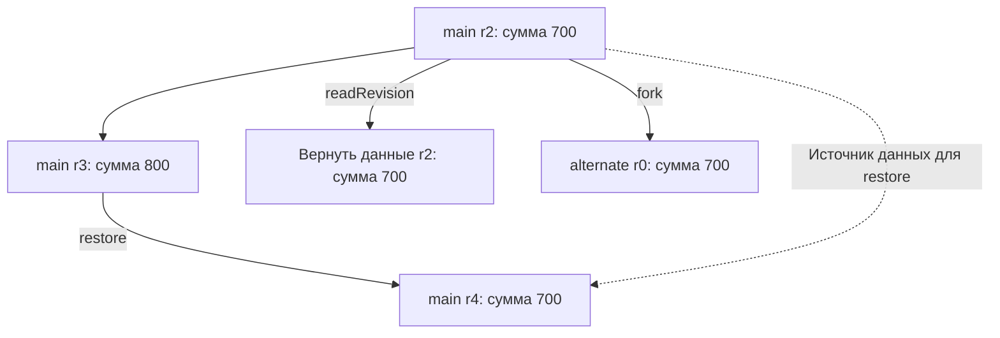

# Сравнение Durable Objects и Duro

В Duro предлагается адресуемый объект с методами и явным хранилищем. У его данных есть история принятых изменений. Приложение сможет читать прошлые версии, создавать независимые ветки и откатывать данные новой ревизией. Контракт ещё предстоит подтвердить реализацией [[1]](#source-1), [[2]](#source-2).

При сравнении с DO нужно отдельно рассматривать удобство API, операции с историей и гарантии исполнения. Новый интерфейс сам по себе не задаёт протокол хранения и восстановления.

## Вызов метода и результат

В Cloudflare клиент получает stub объекта и вызывает его метод через `await stub.method(...)`. Удалённый вызов асинхронен для клиента и передаёт аргументы и результат; поддерживаемые типы шире JSON. [Вызов методов DO](https://developers.cloudflare.com/durable-objects/best-practices/create-durable-object-stubs-and-send-requests/), [RPC Cloudflare](https://developers.cloudflare.com/workers/runtime-apis/rpc/).

Для Duro выбран более узкий контракт: загрузка пакета через `registerType`, явное создание через `create`, затем `invoke` с одним JSON-аргументом и `request_id`. Успешный ответ `{ result, revision }` возвращается после фиксации; метод без значения даёт `result: null`. Наличие результата не определяет долговечность: она обеспечивается фиксацией записей и результата запроса модулем хранения. Совместимость со всем RPC API Cloudflare не предполагается.

## Свойства DO и задачи проектирования

| Свойство DO | Что это означает для проектирования Duro |
| --- | --- |
| [ID отделён от экземпляра](Durable-Objects-Model.md) | В MVP постоянный ID сохраняется при активации и передаче другому исполнителю |
| [Память отделена от storage](Durable-Objects-Storage.md) | В MVP сохраняются явные записи через `storage`; поля и кеши экземпляра временные |
| [Координация ограничена объектом](Durable-Objects-Coordination.md) | Одна команда изменяет один объект; транзакции нескольких объектов отложены |
| [Метод может чередоваться с другими](Durable-Objects-Coordination.md) | В Duro все RPC одного объекта проходят общую очередь, записи метода фиксируются вместе |
| [Один популярный объект ограничивает нагрузку](Durable-Objects-Limitations.md) | История и ветки сами по себе не решают разделение нагрузки |
| [Сбой оставляет неопределённый исход вызова](Durable-Objects-Coordination.md) | Duro фиксирует данные, историю и результат вместе; повтор распознаётся по `request_id` |

## Сравнение PITR с историей и ветвлением

В Cloudflare уже есть [PITR для SQLite-backed объектов](Durable-Objects-Storage.md). Поэтому сравнение с Duro должно учитывать существующее восстановление прошлых данных.

В черновике Duro предлагаются следующие операции:

| Задача | Предлагаемое поведение Duro | Решение для MVP |
| --- | --- | --- |
| Посмотреть прошлую версию | Чтение выбранной ревизии без изменения текущих данных | JSON-данные и версия кода; ревизии хранятся до очистки стенда |
| Продолжить альтернативный вариант | Новый объект из прошлой ревизии | Версия кода выбранной ревизии, `origin`; ссылки остаются значениями |
| Вернуть прежние данные | Новая ревизия исходного объекта | Дополнительная операция; результаты запросов сохраняются, внешние действия и таймеры вне MVP |
| Объяснить изменение | Сохранённые сведения приложения | Автора, причину и предметный смысл сохраняет приложение |

Например, после добавления нового жилья в план поездки пользователь сможет открыть прежний вариант и создать от него альтернативный план. У нового плана должны быть собственная идентичность и независимые дальнейшие изменения. Восстановление текущей БД к прошлому состоянию не задаёт эти правила.

Предлагаемое поведение Duro можно показать на [плане поездки](../concepts/Concepts-Trip.md): в ревизии 2 расходы равны 700, в ревизии 3 к ним добавлено занятие за 100.

`readRevision` возвращает старые данные и оставляет текущую ревизию 3. `fork` создаёт другой объект с собственной нумерацией. `restore` добавляет ревизию 4 в исходный объект, сохраняя ревизию 3 в истории. Это контракт проектируемой Duro; у PITR Cloudflare другой интерфейс и назначение.

Подробная семантика предложена на страницах [истории и веток](../concepts/Concepts-History.md) и [плана поездки](../concepts/Concepts-Trip.md).

## Ограничения истории данных

Журнал записей может восстановить бюджет и список расходов. Для повторного выполнения методов, продолжения прерванного вычисления или объяснения предметного решения нужны дополнительные сведения и правила. Эти различия разобраны в [модели хранения Duro](../concepts/Concepts-Persistence.md).

Копия заявки не должна случайно повторить отправку письма из исходного объекта. Для таймеров и намерений отправки потребуется определить, копируются ли они, отключаются или получают новые ID. В текущем черновике такие возможности отложены; см. [исполнение и восстановление](../concepts/Concepts-Execution.md).

## Сценарии сравнения и развитие

Для сравнения Duro с Cloudflare DO и обычным сервисом можно использовать одинаковый сценарий плана поездки. Это исследовательское сравнение, отдельное от приёмки PoC:

1. Добавить расход с проверкой общего бюджета.
2. Повторить команду после потери ответа.
3. Перезапустить исполнителя между подготовкой и подтверждением изменения.
4. Прочитать прошлую версию и создать независимый вариант.
5. При реализации дополнительного отката вернуть исходные данные и отправить запоздалый повтор старой команды.
6. После MVP добавить обновление кода и проверить работу с ранее сохранённой версией.

Сравнивать стоит объём прикладного кода и понятность поведения в этих случаях. Скорость, стоимость и отказоустойчивость потребуют отдельных измерений при сопоставимых условиях. Подробнее о [проверке гипотезы Duro](../concepts/Concepts-Alternatives.md).

## Литература

[1] Duro. [Vision](../Vision.md). Проектный черновик.

[2] Duro. [Концепции](../concepts/Concepts.md). Проектный черновик.
