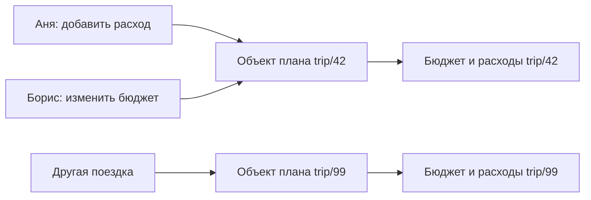

# Durable Objects

У Durable Object есть постоянный адрес, прикладные методы и собственное долговечное хранилище. В Cloudflare запросы к одному ID приходят к одному активному экземпляру объекта, поэтому несколько клиентов могут работать с общим состоянием через его методы. Платформа размещает и запускает экземпляр, а во время работы он хранит временные данные в памяти [[1]](#source-1).

Здесь Durable Objects, или DO, означает продукт Cloudflare. В других системах тоже можно исполнять логику рядом с состоянием адресуемой сущности, но гарантии хранения, обработки вызовов и восстановления у них могут различаться.

## Координация состояния

Представим совместный план поездки. Несколько пользователей одновременно добавляют расходы, а сервер проверяет общий бюджет. Если запросы попадают в разные процессы, им нужно согласовать изменения через БД или другой механизм координации.

В DO каждому плану можно назначить отдельный объект. Запросы к плану попадут к его исполнителю, который работает с собственным хранилищем. Разные планы обслуживаются независимо. Так приложение разбивается на логические единицы, у каждой из которых есть адрес и состояние [[2]](#source-2).



Worker направляет запрос к нужному плану. Например:

```javascript
const plan = PLANS.getByName("trip/42");
await plan.addExpense("train", 200);
const summary = await plan.getSummary();
```

Здесь `getByName` возвращает ссылку на объект, а `addExpense` и `getSummary` реализует разработчик приложения. Число `200` обозначает расход в условных единицах. Подробнее о вызовах через Worker на странице [модели объекта](Durable-Objects-Model.md).

У обычного Worker следующий запрос может попасть в другой экземпляр, которому недоступны прежние переменные. У DO сохраняется адрес для обращения к состоянию. Данные, которые должны пережить перезапуск, разработчик явно записывает в хранилище. Изменение поля класса их не сохраняет [[3]](#source-3), [[4]](#source-4).

## Структура раздела

| Раздел | Содержание |
| --- | --- |
| [Модель и жизненный цикл](Durable-Objects-Model.md) | Адресация объектов и жизненный цикл экземпляров |
| [Хранение и восстановление](Durable-Objects-Storage.md) | Память, долговечные данные и восстановление |
| [Конкурентность и гарантии](Durable-Objects-Coordination.md) | Конкурентные вызовы, атомарность и повторы |
| [Сценарии применения](Durable-Objects-Use-Cases.md) | Сценарии применения и выбор границы объекта |
| [Проблемы и ограничения](Durable-Objects-Limitations.md) | Ограничения масштабирования, задержки и эксплуатации |
| [Сравнение с Duro](Durable-Objects-and-Duro.md) | Свойства исходной модели и задачи проектирования Duro |
| [Обзор источников](Durable-Objects-Sources.md) | Основные публикации и документация |

## Сравнение с другими моделями

| Понятие | Связь с Durable Objects |
| --- | --- |
| Виртуальный актор | Идентичность и поведение логической сущности отделены от конкретного процесса. Например, Orleans автоматически активирует адресуемые grains. DO близок к этой модели; гарантии систем нужно сравнивать отдельно [[5]](#source-5) |
| Durable execution | Сохранение прогресса многошагового исполнения и повтор шагов. Cloudflare Workflows предоставляет шаги, ожидания и повторы; произвольный метод DO такого контракта не получает [[6]](#source-6) |
| Object storage | В R2 или S3 объект означает именованный набор байтов. DO добавляет исполнение кода и координацию. R2 можно использовать рядом с DO для файлов [[7]](#source-7) |

API и ограничения приведены на 22 октября 2026 года. Условия из старых публикаций могли измениться; при выборе API стоит обращаться к документации. Проектируемая модель Duro описана в [Vision](../Vision.md) и [концепциях](../concepts/Concepts.md).

## Литература

<a id="source-1"></a>

[1] Cloudflare. [What are Durable Objects?](https://developers.cloudflare.com/durable-objects/concepts/what-are-durable-objects/). Документация.

<a id="source-2"></a>

[2] Kenton Varda. [Workers Durable Objects Beta: A New Approach to Stateful Serverless](https://blog.cloudflare.com/introducing-workers-durable-objects/). Cloudflare Blog, 28 сентября 2020 года.

<a id="source-3"></a>

[3] Cloudflare. [Durable Objects](https://developers.cloudflare.com/durable-objects/). Документация.

<a id="source-4"></a>

[4] Cloudflare. [Access Durable Objects Storage](https://developers.cloudflare.com/durable-objects/best-practices/access-durable-objects-storage/). Документация.

<a id="source-5"></a>

[5] Microsoft. [Microsoft Orleans](https://learn.microsoft.com/en-us/dotnet/orleans/overview). Microsoft Learn. Документация.

<a id="source-6"></a>

[6] Cloudflare. [Cloudflare Workflows](https://developers.cloudflare.com/workflows/). Документация.

<a id="source-7"></a>

[7] Cloudflare. [Choosing a data or storage product](https://developers.cloudflare.com/workers/platform/storage-options/). Документация.
